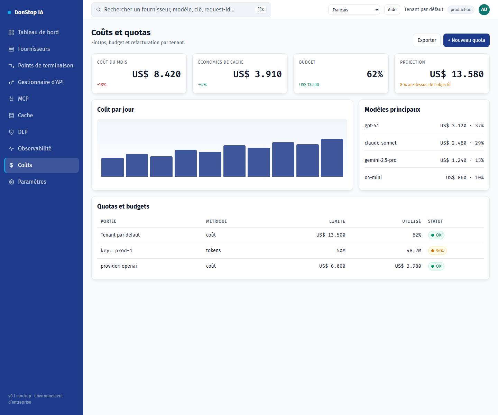

# Coûts

## Ce que fait cet écran

Affiche les coûts journaliers et mensuels, la projection, le budget et les quotas par tenant, clé et fournisseur.

## Quand l’utiliser

Utilisez cet écran pour inspecter, configurer ou exploiter cette partie de la passerelle.

## Étape par étape

1. Ouvrez **Coûts** depuis la barre latérale.
2. Vérifiez les indicateurs et le tableau principal.
3. Utilisez les actions décrites ci-dessous ; les changements s’appliquent immédiatement.
4. Définissez quotas et budgets, puis exportez le rapport de refacturation.

## Champs et actions

| Champ ou action | Libellé ou action visible sur cet écran. |
|---|---|
| Coût aujourd'hui | Libellé ou action visible sur cet écran. |
| Coût du mois | Libellé ou action visible sur cet écran. |
| Projection | Libellé ou action visible sur cet écran. |
| Budget | Libellé ou action visible sur cet écran. |
| Quotas et budgets | Libellé ou action visible sur cet écran. |

## Erreurs et états courants

- Si les données ne se chargent pas, réessayez. Si le problème persiste, vérifiez la passerelle et les fournisseurs.
- Si une action est désactivée, confirmez votre rôle et le périmètre du tenant.
- Les états vides sont normaux avant la première requête ; suivez l’appel à l’action.

## Guides associés

- [Tableau de bord](dashboard.md)
- [Gestionnaire d'API](api-manager.md)
- [Cache](cache.md)

> Capture d’écran de Coûts en Français.
