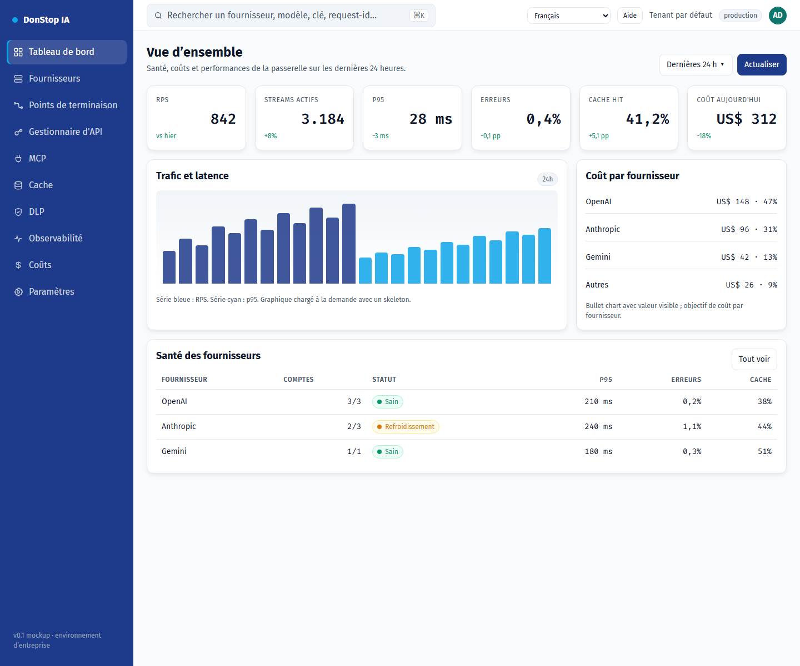

# Tableau de bord

## Ce que fait cet écran

Affiche la santé de la passerelle, le trafic, les coûts et l’état des fournisseurs sur les dernières 24 heures.

## Quand l’utiliser

Utilisez cet écran pour inspecter, configurer ou exploiter cette partie de la passerelle.

## Étape par étape

1. Ouvrez **Tableau de bord** depuis la barre latérale.
2. Vérifiez les indicateurs et le tableau principal.
3. Utilisez les actions décrites ci-dessous ; les changements s’appliquent immédiatement.
4. Vérifiez la santé des fournisseurs et les incidents avant d’ouvrir une trace détaillée.

## Champs et actions

| Champ ou action | Libellé ou action visible sur cet écran. |
|---|---|
| Clés actives | Libellé ou action visible sur cet écran. |
| Requêtes 24 h | Libellé ou action visible sur cet écran. |
| Coût 24 h | Libellé ou action visible sur cet écran. |
| Expire bientôt | Libellé ou action visible sur cet écran. |
| Santé des fournisseurs | Libellé ou action visible sur cet écran. |

## Erreurs et états courants

- Si les données ne se chargent pas, réessayez. Si le problème persiste, vérifiez la passerelle et les fournisseurs.
- Si une action est désactivée, confirmez votre rôle et le périmètre du tenant.
- Les états vides sont normaux avant la première requête ; suivez l’appel à l’action.

## Guides associés

- [Fournisseurs](providers.md)
- [Observabilité](observability.md)
- [Coûts](cost.md)

> Capture d’écran de Tableau de bord en Français.
