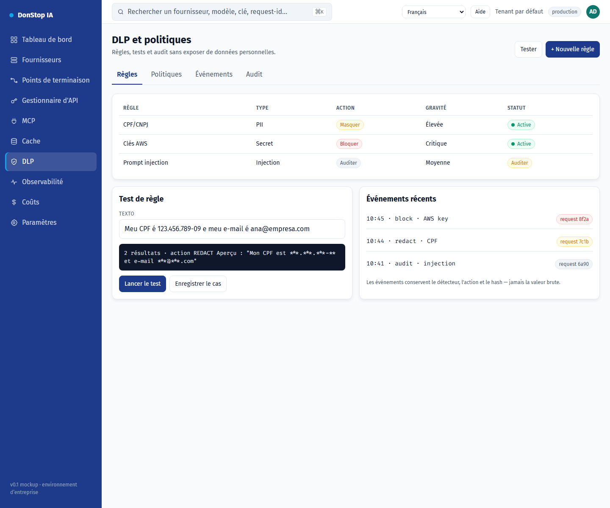

# DLP

## Ce que fait cet écran

Définit les règles et politiques DLP, teste le masquage et audite les événements sans exposer de données personnelles.

## Quand l’utiliser

Utilisez cet écran pour inspecter, configurer ou exploiter cette partie de la passerelle.

## Étape par étape

1. Ouvrez **DLP** depuis la barre latérale.
2. Vérifiez les indicateurs et le tableau principal.
3. Utilisez les actions décrites ci-dessous ; les changements s’appliquent immédiatement.
4. Lancez un test de règle avec un texte d’exemple et confirmez l’action avant activation.

## Champs et actions

| Champ ou action | Libellé ou action visible sur cet écran. |
|---|---|
| Règles | Libellé ou action visible sur cet écran. |
| Action | Libellé ou action visible sur cet écran. |
| Gravité | Libellé ou action visible sur cet écran. |
| Statut | Libellé ou action visible sur cet écran. |
| Lancer le test | Libellé ou action visible sur cet écran. |

## Erreurs et états courants

- Si les données ne se chargent pas, réessayez. Si le problème persiste, vérifiez la passerelle et les fournisseurs.
- Si une action est désactivée, confirmez votre rôle et le périmètre du tenant.
- Les états vides sont normaux avant la première requête ; suivez l’appel à l’action.

## Guides associés

- [Observabilité](observability.md)
- [Gestionnaire d'API](api-manager.md)
- [Cache](cache.md)

> Capture d’écran de DLP en Français.
