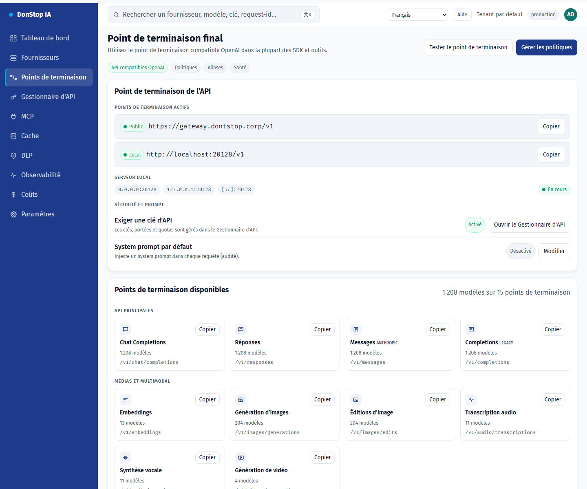

# Points de terminaison

## Ce que fait cet écran

Affiche le point de terminaison final, les URL publiques et locales, les routes, les alias CLI et le system prompt optionnel.

## Quand l’utiliser

Utilisez cet écran pour inspecter, configurer ou exploiter cette partie de la passerelle.

## Étape par étape

1. Ouvrez **Points de terminaison** depuis la barre latérale.
2. Vérifiez les indicateurs et le tableau principal.
3. Utilisez les actions décrites ci-dessous ; les changements s’appliquent immédiatement.
4. Copiez l’URL publique ou locale et utilisez les alias CLI ; aucun tunnel n’est proposé.

## Champs et actions

| Champ ou action | Libellé ou action visible sur cet écran. |
|---|---|
| URL de base | Libellé ou action visible sur cet écran. |
| Public | Libellé ou action visible sur cet écran. |
| Local | Libellé ou action visible sur cet écran. |
| Points de terminaison disponibles | Libellé ou action visible sur cet écran. |
| Alias pour les CLI | Libellé ou action visible sur cet écran. |

## Erreurs et états courants

- Si les données ne se chargent pas, réessayez. Si le problème persiste, vérifiez la passerelle et les fournisseurs.
- Si une action est désactivée, confirmez votre rôle et le périmètre du tenant.
- Les états vides sont normaux avant la première requête ; suivez l’appel à l’action.

## Guides associés

- [Gestionnaire d'API](api-manager.md)
- [Fournisseurs](providers.md)
- [MCP](mcp.md)

> Capture d’écran de Points de terminaison en Français.
