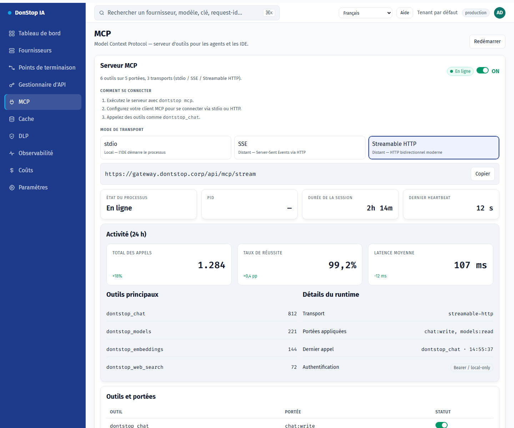

# MCP

## Ce que fait cet écran

Contrôle le serveur MCP : activation globale, transport, état, activité et outils exposés.

## Quand l’utiliser

Utilisez cet écran pour inspecter, configurer ou exploiter cette partie de la passerelle.

## Étape par étape

1. Ouvrez **MCP** depuis la barre latérale.
2. Vérifiez les indicateurs et le tableau principal.
3. Utilisez les actions décrites ci-dessous ; les changements s’appliquent immédiatement.
4. Activez le serveur, choisissez un transport et copiez la commande ou l’URL.

## Champs et actions

| Champ ou action | Libellé ou action visible sur cet écran. |
|---|---|
| Serveur MCP | Libellé ou action visible sur cet écran. |
| Mode de transport | Libellé ou action visible sur cet écran. |
| Activité (24 h) | Libellé ou action visible sur cet écran. |
| Outils et portées | Libellé ou action visible sur cet écran. |
| Redémarrer | Libellé ou action visible sur cet écran. |

## Erreurs et états courants

- Si les données ne se chargent pas, réessayez. Si le problème persiste, vérifiez la passerelle et les fournisseurs.
- Si une action est désactivée, confirmez votre rôle et le périmètre du tenant.
- Les états vides sont normaux avant la première requête ; suivez l’appel à l’action.

## Guides associés

- [Gestionnaire d'API](api-manager.md)
- [Points de terminaison](endpoints.md)
- [Paramètres](settings.md)

> Capture d’écran de MCP en Français.
