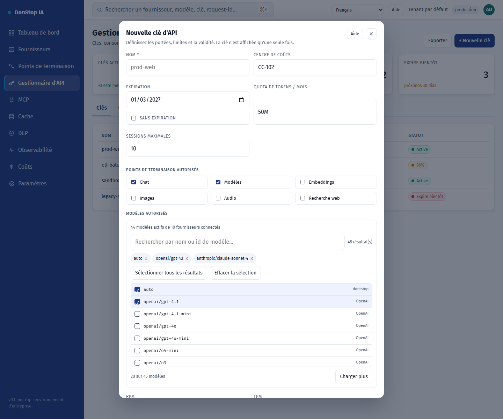

# Nouvelle clé d'API

## Ce que fait cet écran

Crée une clé d’API avec portées, restrictions de modèles, quotas, expiration et limites IP/session.

## Quand l’utiliser

Utilisez cet écran pour inspecter, configurer ou exploiter cette partie de la passerelle.

## Étape par étape

1. Ouvrez **Nouvelle clé d'API** depuis la barre latérale.
2. Vérifiez les indicateurs et le tableau principal.
3. Utilisez les actions décrites ci-dessous ; les changements s’appliquent immédiatement.
4. Remplissez les champs, sélectionnez les modèles, créez la clé et copiez-la une seule fois.

## Champs et actions

| Champ ou action | Libellé ou action visible sur cet écran. |
|---|---|
| Nom * | Libellé ou action visible sur cet écran. |
| Centre de coûts | Libellé ou action visible sur cet écran. |
| Expiration | Libellé ou action visible sur cet écran. |
| Quota de tokens / mois | Libellé ou action visible sur cet écran. |
| Points de terminaison autorisés | Libellé ou action visible sur cet écran. |
| Modèles autorisés | Libellé ou action visible sur cet écran. |

## Erreurs et états courants

- Si les données ne se chargent pas, réessayez. Si le problème persiste, vérifiez la passerelle et les fournisseurs.
- Si une action est désactivée, confirmez votre rôle et le périmètre du tenant.
- Les états vides sont normaux avant la première requête ; suivez l’appel à l’action.

## Guides associés

- [Gestionnaire d'API](api-manager.md)
- [Points de terminaison](endpoints.md)
- [Coûts](cost.md)

> Capture d’écran de Nouvelle clé d'API en Français.
