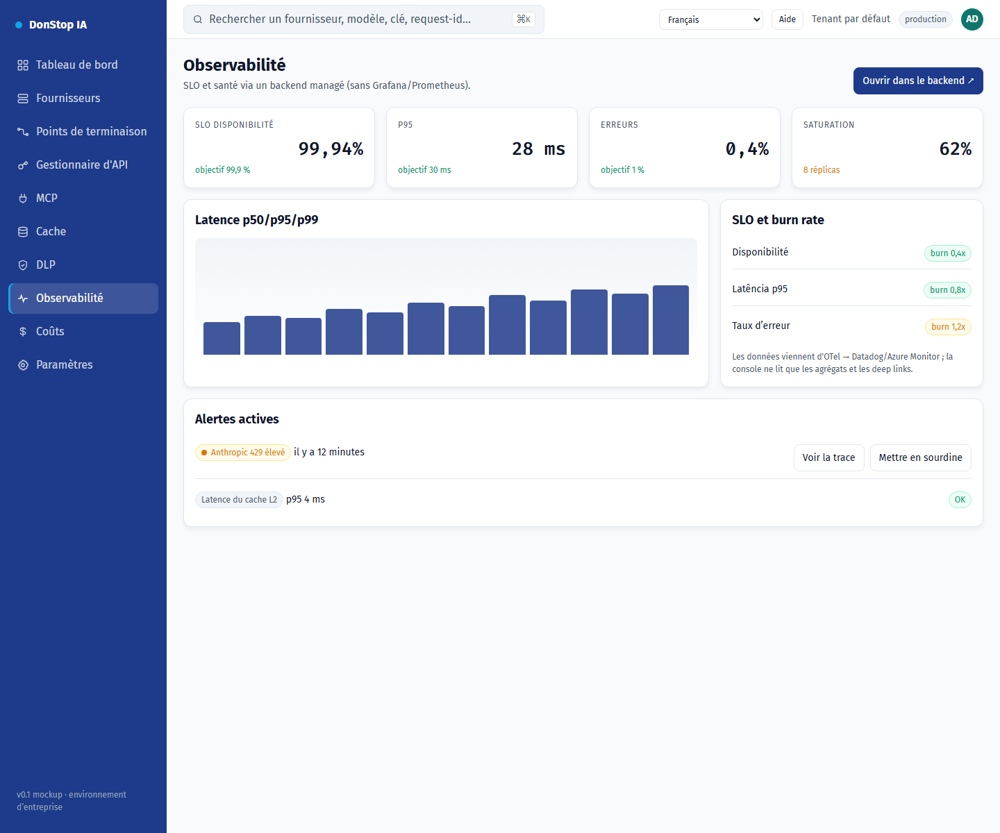

# Observabilité

## Ce que fait cet écran

Affiche les SLO, la disponibilité, les alertes, le trafic et la latence, avec des liens vers le backend managé.

## Quand l’utiliser

Utilisez cet écran pour inspecter, configurer ou exploiter cette partie de la passerelle.

## Étape par étape

1. Ouvrez **Observabilité** depuis la barre latérale.
2. Vérifiez les indicateurs et le tableau principal.
3. Utilisez les actions décrites ci-dessous ; les changements s’appliquent immédiatement.
4. Utilisez les liens pour ouvrir les traces et le détail des SLO dans le backend managé.

## Champs et actions

| Champ ou action | Libellé ou action visible sur cet écran. |
|---|---|
| Disponibilité | Libellé ou action visible sur cet écran. |
| SLO et burn rate | Libellé ou action visible sur cet écran. |
| Alertes actives | Libellé ou action visible sur cet écran. |
| Trafic et latence | Libellé ou action visible sur cet écran. |
| Ouvrir dans le backend ↗ | Libellé ou action visible sur cet écran. |

## Erreurs et états courants

- Si les données ne se chargent pas, réessayez. Si le problème persiste, vérifiez la passerelle et les fournisseurs.
- Si une action est désactivée, confirmez votre rôle et le périmètre du tenant.
- Les états vides sont normaux avant la première requête ; suivez l’appel à l’action.

## Guides associés

- [Tableau de bord](dashboard.md)
- [DLP](dlp.md)
- [Coûts](cost.md)

> Capture d’écran de Observabilité en Français.
