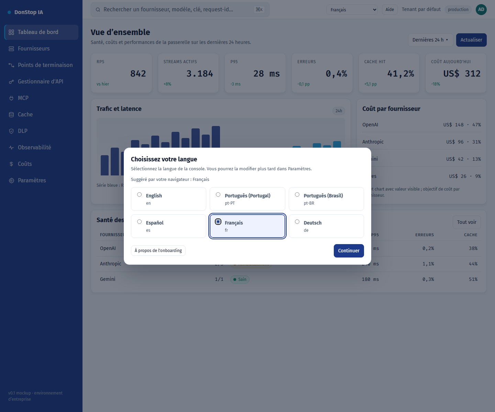

# Onboarding

## Ce que fait cet écran

Apparaît au premier accès pour choisir la langue de l’interface, présélectionnée par le navigateur.

## Quand l’utiliser

Utilisez cet écran pour inspecter, configurer ou exploiter cette partie de la passerelle.

## Étape par étape

1. Ouvrez **Onboarding** depuis la barre latérale.
2. Vérifiez les indicateurs et le tableau principal.
3. Utilisez les actions décrites ci-dessous ; les changements s’appliquent immédiatement.
4. Choisissez la langue suggérée ou une autre, puis sélectionnez Continuer.

## Champs et actions

| Champ ou action | Libellé ou action visible sur cet écran. |
|---|---|
| Langue de l'interface | Libellé ou action visible sur cet écran. |
| Suggéré par votre navigateur : {locale} | Libellé ou action visible sur cet écran. |
| Continuer | Libellé ou action visible sur cet écran. |
| À propos de l'onboarding | Libellé ou action visible sur cet écran. |

## Erreurs et états courants

- Si les données ne se chargent pas, réessayez. Si le problème persiste, vérifiez la passerelle et les fournisseurs.
- Si une action est désactivée, confirmez votre rôle et le périmètre du tenant.
- Les états vides sont normaux avant la première requête ; suivez l’appel à l’action.

## Guides associés

- [Paramètres](settings.md)
- [Tableau de bord](dashboard.md)
- [Gestionnaire d'API](api-manager.md)

> Capture d’écran de Onboarding en Français.
