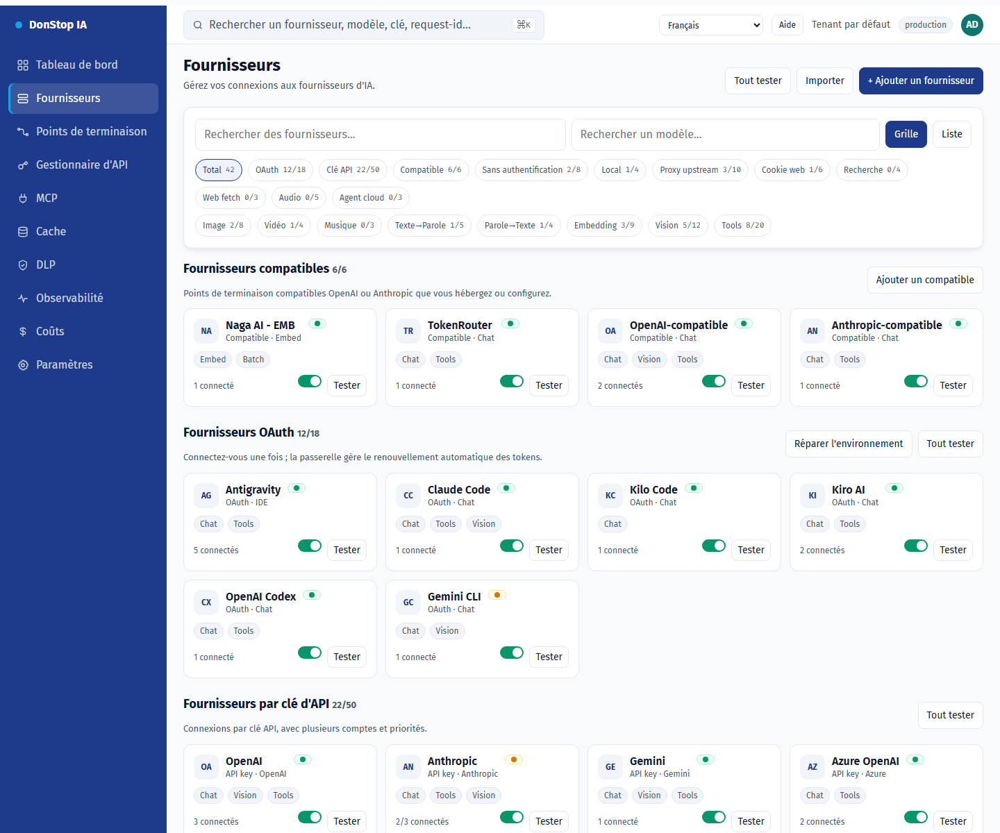
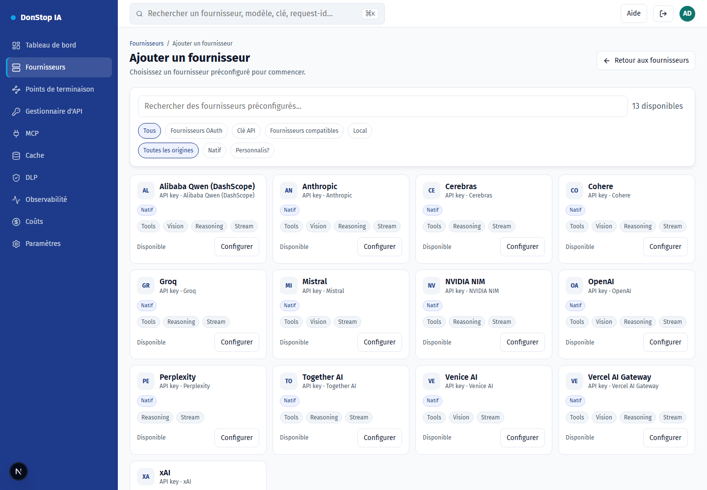
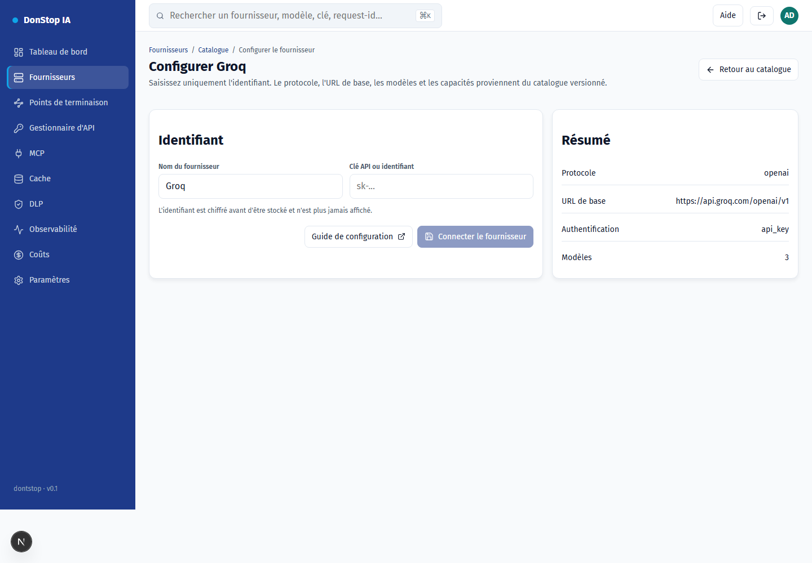
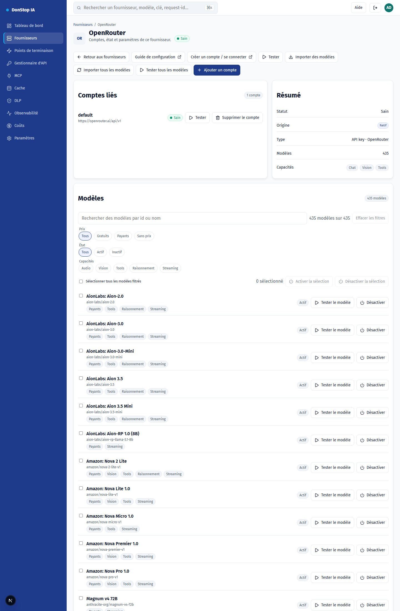

# Configuration des fournisseurs

Chaque fournisseur est déjà dans le catalogue versionné : protocole, URL de base, modèles et capacités. Vous fournissez uniquement l'identifiant.

## Comment configurer

1. Ouvrez Fournisseurs et choisissez Ajouter un fournisseur (ou la carte du fournisseur dans le catalogue).
2. Sélectionnez le fournisseur et cliquez sur Configurer.
3. Créez la clé API dans la console du fournisseur (lien ci-dessous).
4. Collez la clé dans le champ Identifiant et confirmez.
5. Le fournisseur rejoint la liste des fournisseurs configurés ; testez-le et importez des modèles si besoin.

## Étape par étape

## Fournisseurs pris en charge

| Provider | Auth | Base URL |
|---|---|---|
| Alibaba Qwen (DashScope) | API key | https://dashscope-intl.aliyuncs.com/compatible-mode/v1 |
| Anthropic | API key | https://api.anthropic.com |
| Cerebras | API key | https://api.cerebras.ai/v1 |
| Cohere | API key | https://api.cohere.com/compatibility/v1 |
| Groq | API key | https://api.groq.com/openai/v1 |
| Mistral | API key | https://api.mistral.ai/v1 |
| NVIDIA NIM | API key | https://integrate.api.nvidia.com/v1 |
| OpenAI | API key | https://api.openai.com/v1 |
| OpenRouter | API key | https://openrouter.ai/api/v1 |
| Perplexity | API key | https://api.perplexity.ai |
| Together AI | API key | https://api.together.xyz/v1 |
| Venice AI | API key | https://api.venice.ai/api/v1 |
| Vercel AI Gateway | API key | https://ai-gateway.vercel.sh/v1 |
| xAI | API key | https://api.x.ai/v1 |

## Alibaba Qwen (DashScope)

- Auth: API key
- Base URL: https://dashscope-intl.aliyuncs.com/compatible-mode/v1
- Crie a chave no Alibaba Cloud Model Studio (DashScope) e use o endpoint internacional.

## Anthropic

- Auth: API key
- Base URL: https://api.anthropic.com
- O gateway envia x-api-key e anthropic-version; não inclua esses headers manualmente.

## Cerebras

- Auth: API key
- Base URL: https://api.cerebras.ai/v1
- Compatível com OpenAI; use a chave do console da Cerebras.

## Cohere

- Auth: API key
- Base URL: https://api.cohere.com/compatibility/v1
- Use o endpoint de compatibilidade (/compatibility) e a chave do dashboard da Cohere.

## Groq

- Auth: API key
- Base URL: https://api.groq.com/openai/v1
- Compatível com OpenAI; a chave é criada no console da Groq.

## Mistral

- Auth: API key
- Base URL: https://api.mistral.ai/v1
- Compatível com OpenAI; use a chave do console da Mistral.

## NVIDIA NIM

- Auth: API key
- Base URL: https://integrate.api.nvidia.com/v1
- O endpoint de modelos é público; a credencial é exigida nas inferências.

## OpenAI

- Auth: API key
- Base URL: https://api.openai.com/v1
- Use uma chave de projeto. A organizaão/projeto não são enviados pelo gateway.

## OpenRouter

- Auth: API key
- Base URL: https://openrouter.ai/api/v1
- Importe modelos pelo botão Importar modelos ou use o modelo auto.

## Perplexity

- Auth: API key
- Base URL: https://api.perplexity.ai
- Perplexity não expõe /models: o teste e a importação de modelos ficam indisponíveis; o chat funciona.

## Together AI

- Auth: API key
- Base URL: https://api.together.xyz/v1
- Compatível com OpenAI; use a chave em api.together.ai.

## Venice AI

- Auth: API key
- Base URL: https://api.venice.ai/api/v1
- Compatível com OpenAI; a chave é criada em Settings > API.

## Vercel AI Gateway

- Auth: API key
- Base URL: https://ai-gateway.vercel.sh/v1
- Os IDs de modelo são namespaced (ex.: openai/gpt-4.1).

## xAI

- Auth: API key
- Base URL: https://api.x.ai/v1
- Use a chave do console da xAI; o gateway usa o endpoint de chat.

## Filtres et actions groupées

- Filtrez par prix (gratuit/payant/sans prix), capacités (audio, vision, tools, raisonnement, streaming), état ou texte.
- Sélectionnez tous les modèles filtrés puis activez ou désactivez-les en une fois ; l'application confirme le nombre et signale chaque échec.
- Les filtres reposent sur les métadonnées du fournisseur ; sans métadonnées, le modèle affiche « sans métadonnées » et n'est jamais déduit du nom.
## Modèles

- **Synchroniser les modèles** importe tout ce que le fournisseur annonce et conserve l'état actif/inactif des modèles existants.
- **Tester le modèle** envoie une requête minimale pour valider l'identifiant et la disponibilité.
- **Activer/Désactiver** détermine si le modèle apparaît dans `/v1/models` et reçoit du trafic.
- **Tester tous les modèles** met en file tous les modèles configurés et exécute les tests en arrière-plan, un par un.
- **Importer tous les modèles** enregistre tout ce que le fournisseur annonce en un clic.

## Champs

| Field | Description |
|---|---|
| Identifiant | Clé API créée dans la console du fournisseur. Elle est chiffrée avant stockage. |
| Nom du fournisseur | Libellé facultatif pour cette instance. |
| URL de base | Remplacement facultatif ; vide utilise la valeur du catalogue. |

## Erreurs courantes

- 401 : clé invalide ou expirée. Créez-en une autre et réessayez.
- 402 : le compte du fournisseur n'a plus de crédit.
- 429 : limite de débit du fournisseur. Attendez le cooldown.
- Fournisseur hors catalogue : aucun adaptateur n'existe encore dans la passerelle.
