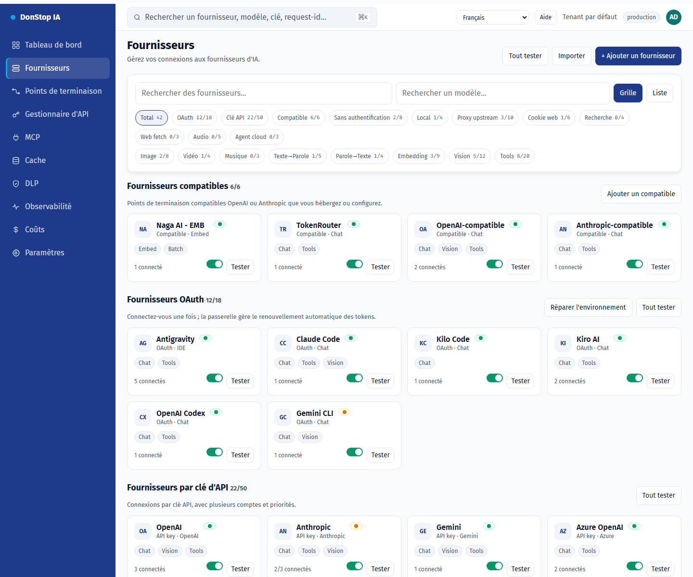

# Fournisseurs

## Ce que fait cet écran

Liste les fournisseurs d’IA, les comptes, l’état des connexions et les modèles disponibles, avec vues grille/liste et tests.

## Quand l’utiliser

Utilisez cet écran pour inspecter, configurer ou exploiter cette partie de la passerelle.

## Étape par étape

1. Ouvrez **Fournisseurs** depuis la barre latérale.
2. Vérifiez les indicateurs et le tableau principal.
3. Utilisez les actions décrites ci-dessous ; les changements s’appliquent immédiatement.
4. Utilisez Grille/Liste, filtrez par authentification ou capacité, puis testez le fournisseur avant activation.

## Champs et actions

| Champ ou action | Libellé ou action visible sur cet écran. |
|---|---|
| + Ajouter un fournisseur | Libellé ou action visible sur cet écran. |
| Grille | Libellé ou action visible sur cet écran. |
| Liste | Libellé ou action visible sur cet écran. |
| Tester | Libellé ou action visible sur cet écran. |
| Statut | Libellé ou action visible sur cet écran. |

## Erreurs et états courants

- Si les données ne se chargent pas, réessayez. Si le problème persiste, vérifiez la passerelle et les fournisseurs.
- Si une action est désactivée, confirmez votre rôle et le périmètre du tenant.
- Les états vides sont normaux avant la première requête ; suivez l’appel à l’action.

## Proxy par compte

Configurez Webshare dans **Réseau proxy**, testez l'API key et synchronisez la liste des proxies direct. Dans le compte du fournisseur, choisissez Off, Preferred ou Required ; l'endpoint attribué, la région et la santé apparaissent dans le même bloc. Un proxy en quarantaine ou absent bascule en direct avec Preferred et bloque l'appel avec Required.

## Comptes et tests

Le détail du fournisseur conserve le résumé consolidé et ajoute un résumé par compte avec état actif, santé, modèles disponibles/utilisables et capacités. Utilisez le sélecteur **Compte de test** au-dessus de la liste des modèles pour choisir le compte utilisé. Seuls les comptes actifs avec des modèles utilisables sont sélectionnables, le dernier choix valide est mémorisé et le résultat indique toujours le compte utilisé. Chaque compte possède aussi son bouton de test ; l'échec d'un compte n'affecte pas les autres.

## Guides associés

- [Points de terminaison](endpoints.md)
- [Tableau de bord](dashboard.md)
- [Coûts](cost.md)

> Capture d’écran de Fournisseurs en Français.
