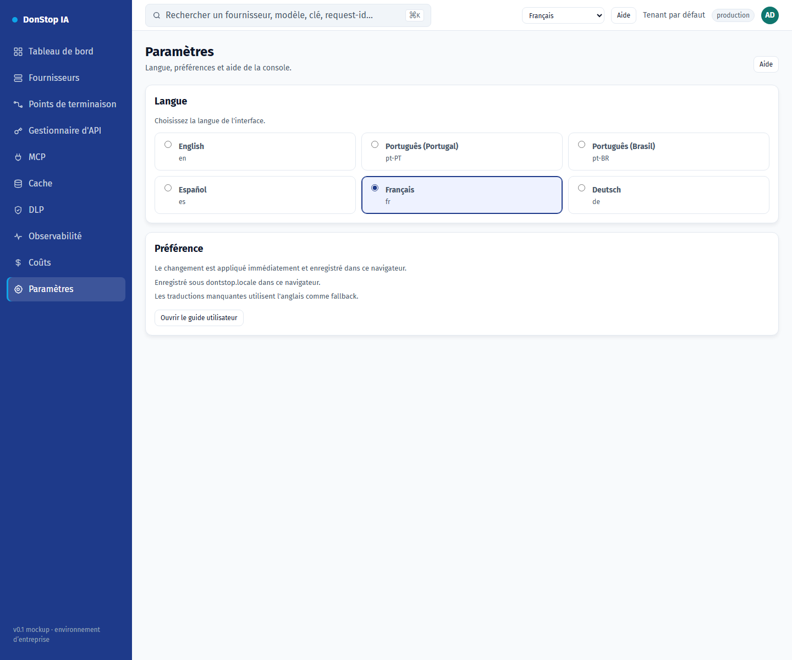

# Paramètres

## Ce que fait cet écran

Permet de changer la langue de l’interface et de vérifier où la préférence est stockée.

## Quand l’utiliser

Utilisez cet écran pour inspecter, configurer ou exploiter cette partie de la passerelle.

## Étape par étape

1. Ouvrez **Paramètres** depuis la barre latérale.
2. Vérifiez les indicateurs et le tableau principal.
3. Utilisez les actions décrites ci-dessous ; les changements s’appliquent immédiatement.
4. Choisissez une langue ; l’interface se met à jour immédiatement et le choix est enregistré.

## Champs et actions

| Champ ou action | Libellé ou action visible sur cet écran. |
|---|---|
| Langue | Libellé ou action visible sur cet écran. |
| Préférence | Libellé ou action visible sur cet écran. |
| Enregistré sous dontstop.locale dans ce navigateur. | Libellé ou action visible sur cet écran. |
| Les traductions manquantes utilisent l'anglais comme fallback. | Libellé ou action visible sur cet écran. |
| Ouvrir le guide utilisateur | Libellé ou action visible sur cet écran. |

## Erreurs et états courants

- Si les données ne se chargent pas, réessayez. Si le problème persiste, vérifiez la passerelle et les fournisseurs.
- Si une action est désactivée, confirmez votre rôle et le périmètre du tenant.
- Les états vides sont normaux avant la première requête ; suivez l’appel à l’action.

## Guides associés

- [Onboarding](onboarding.md)
- [Gestionnaire d'API](api-manager.md)
- [MCP](mcp.md)

> Capture d’écran de Paramètres en Français.
