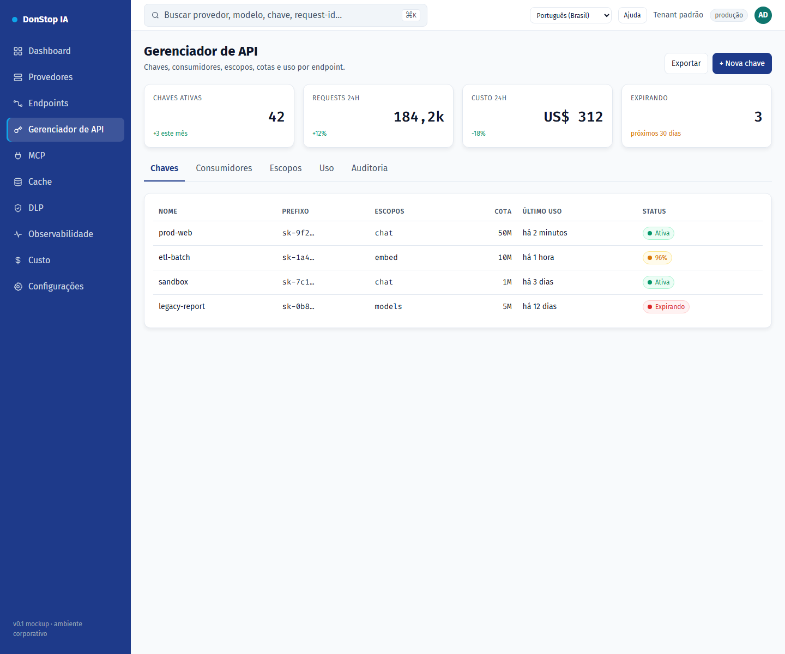

# Gerenciador de API

## O que faz

Gerencia chaves de API, escopos, cotas, limites de taxa, expiração e uso por endpoint.

## Quando usar

Use esta tela quando precisar inspecionar, configurar ou operar esta parte do gateway.

## Passo a passo

1. Abra **Gerenciador de API** pela barra lateral.
2. Revise os indicadores e a tabela principal.
3. Use as ações descritas abaixo; as mudanças valem imediatamente.
4. Abra uma chave para revisar escopos e uso, ou use + Nova chave para criar uma.

## Campos e ações

| Campo ou ação | Rótulo ou ação visível nesta tela. |
|---|---|
| + Nova chave | Rótulo ou ação visível nesta tela. |
| Chaves | Rótulo ou ação visível nesta tela. |
| Escopos | Rótulo ou ação visível nesta tela. |
| Cota | Rótulo ou ação visível nesta tela. |
| Último uso | Rótulo ou ação visível nesta tela. |
| Status | Rótulo ou ação visível nesta tela. |

## Erros e estados comuns

- Se os dados não carregarem, tente novamente. Se persistir, verifique o gateway e os provedores.
- Se uma ação estiver desabilitada, confirme seu papel e o escopo do tenant.
- Estados vazios são esperados antes da primeira requisição; siga a chamada para ação.

## Guias relacionados

- [Nova chave de API](new-api-key.md)
- [Endpoints](endpoints.md)
- [Custo](cost.md)

> Captura de tela de Gerenciador de API em Português (Brasil).
