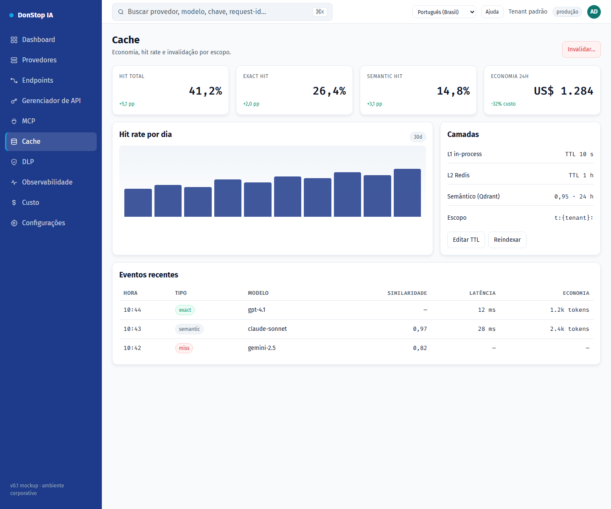

# Cache

## O que faz

Mostra as camadas de cache exato e semântico, hit rate, economia e ações de invalidação.

## Quando usar

Use esta tela quando precisar inspecionar, configurar ou operar esta parte do gateway.

## Passo a passo

1. Abra **Cache** pela barra lateral.
2. Revise os indicadores e a tabela principal.
3. Use as ações descritas abaixo; as mudanças valem imediatamente.
4. Revise o hit rate e a economia e invalide por modelo, provedor ou tenant se necessário.

## Campos e ações

| Campo ou ação | Rótulo ou ação visível nesta tela. |
|---|---|
| Cache hit | Rótulo ou ação visível nesta tela. |
| Economia 24h | Rótulo ou ação visível nesta tela. |
| Camadas | Rótulo ou ação visível nesta tela. |
| Eventos recentes | Rótulo ou ação visível nesta tela. |
| Invalidar… | Rótulo ou ação visível nesta tela. |

## Erros e estados comuns

- Se os dados não carregarem, tente novamente. Se persistir, verifique o gateway e os provedores.
- Se uma ação estiver desabilitada, confirme seu papel e o escopo do tenant.
- Estados vazios são esperados antes da primeira requisição; siga a chamada para ação.

## Guias relacionados

- [Custo](cost.md)
- [Observabilidade](observability.md)
- [DLP](dlp.md)

> Captura de tela de Cache em Português (Brasil).
