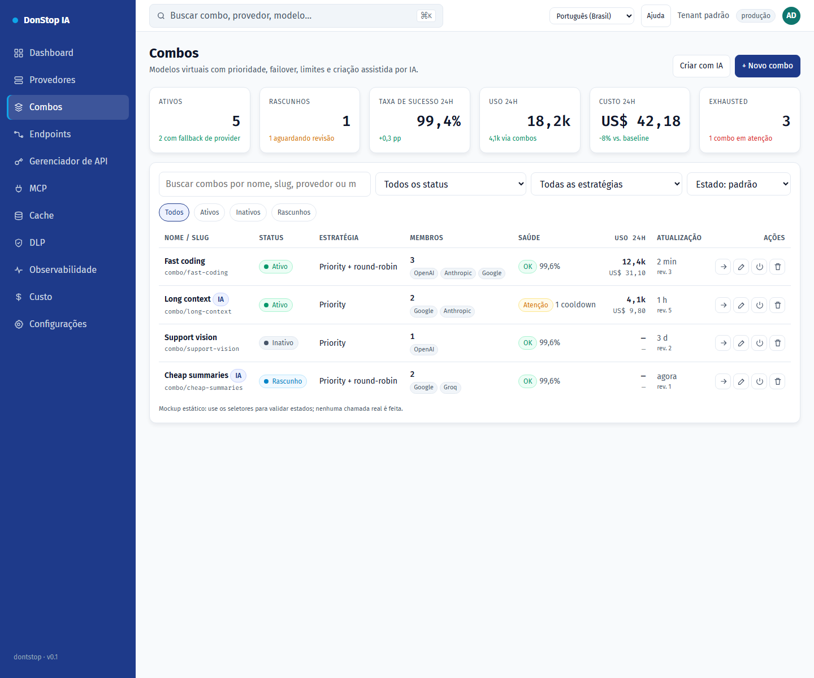

# Combos

## O que faz

Cria e opera modelos virtuais compostos por modelos de provedores, com prioridade, failover, limites e rascunho assistido por IA.

## Quando usar

Use esta tela quando precisar inspecionar, configurar ou operar esta parte do gateway.

## Passo a passo

1. Abra **Combos** pela barra lateral.
2. Revise os indicadores e a tabela principal.
3. Use as ações descritas abaixo; as mudanças valem imediatamente.
4. Crie manualmente ou com IA, revise membros e avisos, valide e só então salve e ative explicitamente.

## Campos e ações

| Campo ou ação | Rótulo ou ação visível nesta tela. |
|---|---|
| Status | Rótulo ou ação visível nesta tela. |
| Editar | Rótulo ou ação visível nesta tela. |
| Testar | Rótulo ou ação visível nesta tela. |
| Fechar | Rótulo ou ação visível nesta tela. |

## Erros e estados comuns

- Se os dados não carregarem, tente novamente. Se persistir, verifique o gateway e os provedores.
- Se uma ação estiver desabilitada, confirme seu papel e o escopo do tenant.
- Estados vazios são esperados antes da primeira requisição; siga a chamada para ação.

## Guias relacionados

- [Provedores](providers.md)
- [Endpoints](endpoints.md)
- [Custo](cost.md)

> Captura de tela de Combos em Português (Brasil).
