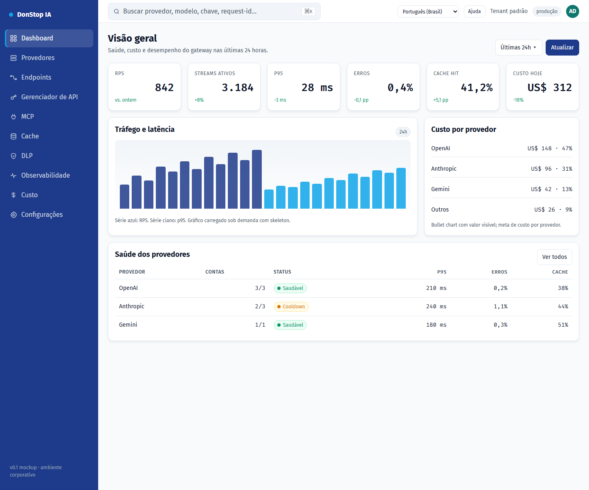

# Dashboard

## O que faz

Mostra a saúde do gateway, tráfego, custo e status dos provedores nas últimas 24 horas.

## Quando usar

Use esta tela quando precisar inspecionar, configurar ou operar esta parte do gateway.

## Passo a passo

1. Abra **Dashboard** pela barra lateral.
2. Revise os indicadores e a tabela principal.
3. Use as ações descritas abaixo; as mudanças valem imediatamente.
4. Verifique a saúde dos provedores e os incidentes antes de abrir um trace detalhado.

## Campos e ações

| Campo ou ação | Rótulo ou ação visível nesta tela. |
|---|---|
| Chaves ativas | Rótulo ou ação visível nesta tela. |
| Requests 24h | Rótulo ou ação visível nesta tela. |
| Custo 24h | Rótulo ou ação visível nesta tela. |
| Expirando | Rótulo ou ação visível nesta tela. |
| Saúde dos provedores | Rótulo ou ação visível nesta tela. |

## Erros e estados comuns

- Se os dados não carregarem, tente novamente. Se persistir, verifique o gateway e os provedores.
- Se uma ação estiver desabilitada, confirme seu papel e o escopo do tenant.
- Estados vazios são esperados antes da primeira requisição; siga a chamada para ação.

## Guias relacionados

- [Provedores](providers.md)
- [Observabilidade](observability.md)
- [Custo](cost.md)

> Captura de tela de Dashboard em Português (Brasil).
