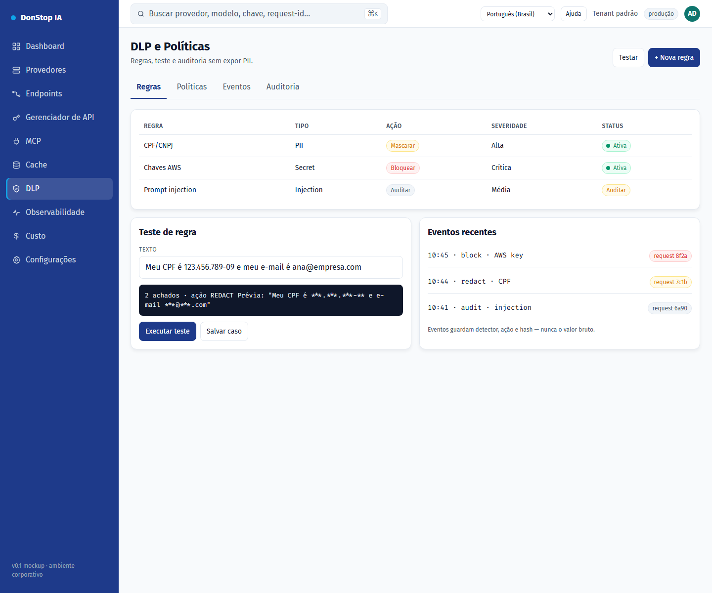

# DLP

## O que faz

Define regras e políticas de DLP, testa a redação e audita eventos sem expor PII.

## Quando usar

Use esta tela quando precisar inspecionar, configurar ou operar esta parte do gateway.

## Passo a passo

1. Abra **DLP** pela barra lateral.
2. Revise os indicadores e a tabela principal.
3. Use as ações descritas abaixo; as mudanças valem imediatamente.
4. Execute um teste de regra com texto de exemplo e confirme a ação antes de ativá-la.

## Campos e ações

| Campo ou ação | Rótulo ou ação visível nesta tela. |
|---|---|
| Regras | Rótulo ou ação visível nesta tela. |
| Ação | Rótulo ou ação visível nesta tela. |
| Severidade | Rótulo ou ação visível nesta tela. |
| Status | Rótulo ou ação visível nesta tela. |
| Executar teste | Rótulo ou ação visível nesta tela. |

## Erros e estados comuns

- Se os dados não carregarem, tente novamente. Se persistir, verifique o gateway e os provedores.
- Se uma ação estiver desabilitada, confirme seu papel e o escopo do tenant.
- Estados vazios são esperados antes da primeira requisição; siga a chamada para ação.

## Guias relacionados

- [Observabilidade](observability.md)
- [Gerenciador de API](api-manager.md)
- [Cache](cache.md)

> Captura de tela de DLP em Português (Brasil).
