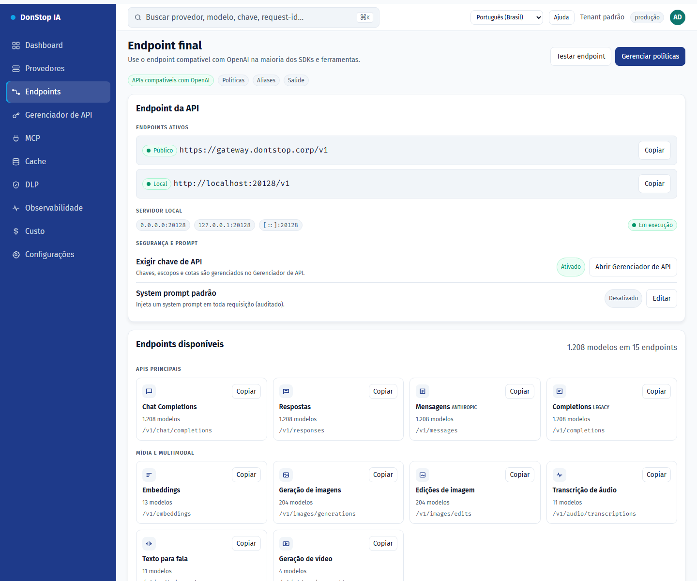

# Endpoints

## O que faz

Mostra o endpoint final da API, URLs pública e local, rotas disponíveis, aliases para CLIs e o system prompt opcional.

## Quando usar

Use esta tela quando precisar inspecionar, configurar ou operar esta parte do gateway.

## Passo a passo

1. Abra **Endpoints** pela barra lateral.
2. Revise os indicadores e a tabela principal.
3. Use as ações descritas abaixo; as mudanças valem imediatamente.
4. Copie a URL pública ou local e use os aliases para CLIs; não há opção de túnel.

## Campos e ações

| Campo ou ação | Rótulo ou ação visível nesta tela. |
|---|---|
| Base URL | Rótulo ou ação visível nesta tela. |
| Público | Rótulo ou ação visível nesta tela. |
| Local | Rótulo ou ação visível nesta tela. |
| Endpoints disponíveis | Rótulo ou ação visível nesta tela. |
| Aliases para CLIs | Rótulo ou ação visível nesta tela. |

## Erros e estados comuns

- Se os dados não carregarem, tente novamente. Se persistir, verifique o gateway e os provedores.
- Se uma ação estiver desabilitada, confirme seu papel e o escopo do tenant.
- Estados vazios são esperados antes da primeira requisição; siga a chamada para ação.

## Guias relacionados

- [Gerenciador de API](api-manager.md)
- [Provedores](providers.md)
- [MCP](mcp.md)

> Captura de tela de Endpoints em Português (Brasil).
