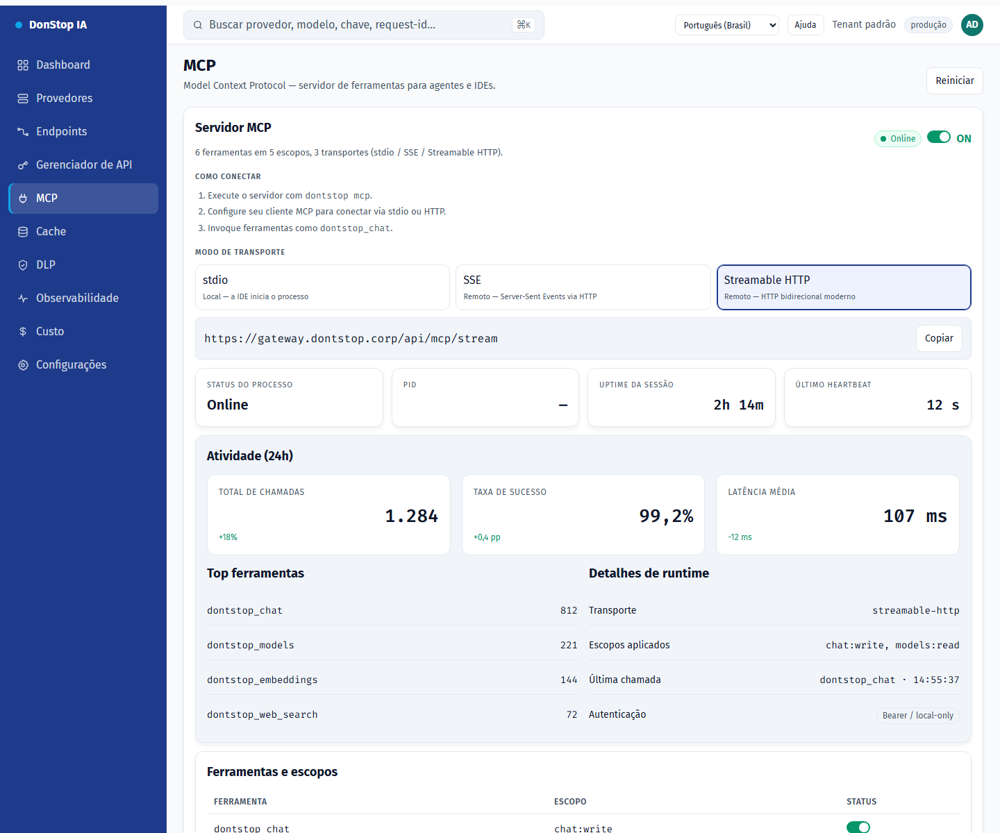

# MCP

## O que faz

Controla o servidor MCP: ativação global, transporte, status, atividade e ferramentas expostas.

## Quando usar

Use esta tela quando precisar inspecionar, configurar ou operar esta parte do gateway.

## Passo a passo

1. Abra **MCP** pela barra lateral.
2. Revise os indicadores e a tabela principal.
3. Use as ações descritas abaixo; as mudanças valem imediatamente.
4. Ative o servidor, escolha um transporte e copie o comando ou a URL.

## Campos e ações

| Campo ou ação | Rótulo ou ação visível nesta tela. |
|---|---|
| Servidor MCP | Rótulo ou ação visível nesta tela. |
| Modo de transporte | Rótulo ou ação visível nesta tela. |
| Atividade (24h) | Rótulo ou ação visível nesta tela. |
| Ferramentas e escopos | Rótulo ou ação visível nesta tela. |
| Reiniciar | Rótulo ou ação visível nesta tela. |

## Erros e estados comuns

- Se os dados não carregarem, tente novamente. Se persistir, verifique o gateway e os provedores.
- Se uma ação estiver desabilitada, confirme seu papel e o escopo do tenant.
- Estados vazios são esperados antes da primeira requisição; siga a chamada para ação.

## Guias relacionados

- [Gerenciador de API](api-manager.md)
- [Endpoints](endpoints.md)
- [Configurações](settings.md)

> Captura de tela de MCP em Português (Brasil).
