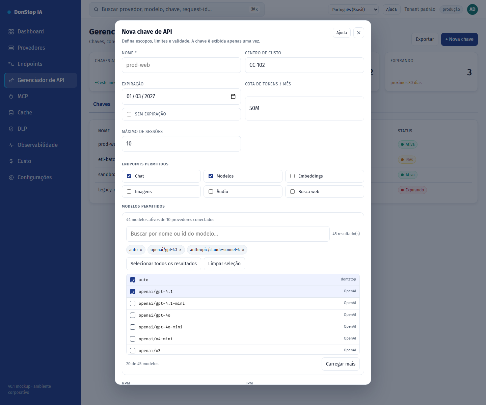

# Nova chave de API

## O que faz

Cria uma chave de API com escopos, restrições de modelo, cotas, expiração e limites de IP/sessão.

## Quando usar

Use esta tela quando precisar inspecionar, configurar ou operar esta parte do gateway.

## Passo a passo

1. Abra **Nova chave de API** pela barra lateral.
2. Revise os indicadores e a tabela principal.
3. Use as ações descritas abaixo; as mudanças valem imediatamente.
4. Preencha os campos, selecione modelos, crie a chave e copie-a uma única vez.

## Campos e ações

| Campo ou ação | Rótulo ou ação visível nesta tela. |
|---|---|
| Nome * | Rótulo ou ação visível nesta tela. |
| Centro de custo | Rótulo ou ação visível nesta tela. |
| Expiração | Rótulo ou ação visível nesta tela. |
| Cota de tokens / mês | Rótulo ou ação visível nesta tela. |
| Endpoints permitidos | Rótulo ou ação visível nesta tela. |
| Modelos permitidos | Rótulo ou ação visível nesta tela. |

## Erros e estados comuns

- Se os dados não carregarem, tente novamente. Se persistir, verifique o gateway e os provedores.
- Se uma ação estiver desabilitada, confirme seu papel e o escopo do tenant.
- Estados vazios são esperados antes da primeira requisição; siga a chamada para ação.

## Guias relacionados

- [Gerenciador de API](api-manager.md)
- [Endpoints](endpoints.md)
- [Custo](cost.md)

> Captura de tela de Nova chave de API em Português (Brasil).
