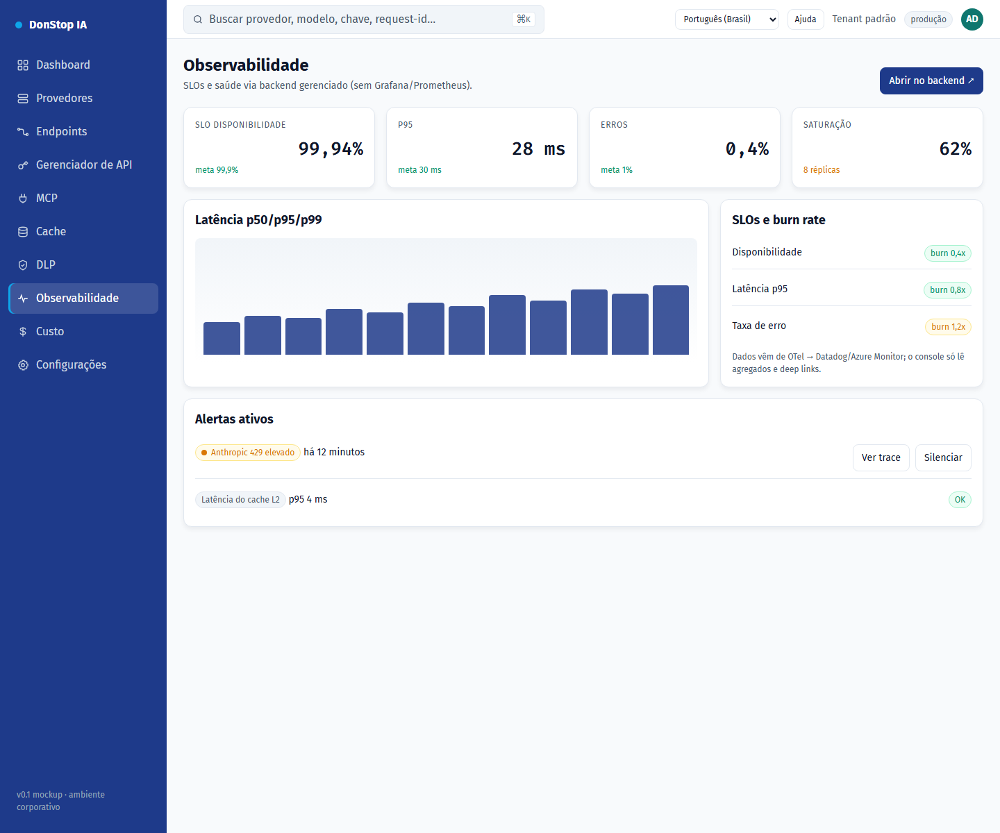

# Observabilidade

## O que faz

Mostra SLOs, disponibilidade, alertas, tráfego e latência, com deep links para o backend gerenciado.

## Quando usar

Use esta tela quando precisar inspecionar, configurar ou operar esta parte do gateway.

## Passo a passo

1. Abra **Observabilidade** pela barra lateral.
2. Revise os indicadores e a tabela principal.
3. Use as ações descritas abaixo; as mudanças valem imediatamente.
4. Use os deep links para abrir traces e detalhes de SLO no backend gerenciado.

## Campos e ações

| Campo ou ação | Rótulo ou ação visível nesta tela. |
|---|---|
| Disponibilidade | Rótulo ou ação visível nesta tela. |
| SLOs e burn rate | Rótulo ou ação visível nesta tela. |
| Alertas ativos | Rótulo ou ação visível nesta tela. |
| Tráfego e latência | Rótulo ou ação visível nesta tela. |
| Abrir no backend ↗ | Rótulo ou ação visível nesta tela. |

## Erros e estados comuns

- Se os dados não carregarem, tente novamente. Se persistir, verifique o gateway e os provedores.
- Se uma ação estiver desabilitada, confirme seu papel e o escopo do tenant.
- Estados vazios são esperados antes da primeira requisição; siga a chamada para ação.

## Guias relacionados

- [Dashboard](dashboard.md)
- [DLP](dlp.md)
- [Custo](cost.md)

> Captura de tela de Observabilidade em Português (Brasil).
