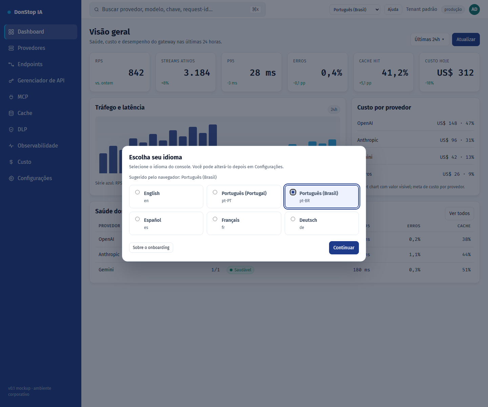

# Onboarding

## O que faz

Aparece no primeiro acesso para escolher o idioma da interface, pré-selecionado pelo navegador.

## Quando usar

Use esta tela quando precisar inspecionar, configurar ou operar esta parte do gateway.

## Passo a passo

1. Abra **Onboarding** pela barra lateral.
2. Revise os indicadores e a tabela principal.
3. Use as ações descritas abaixo; as mudanças valem imediatamente.
4. Escolha o idioma sugerido ou outro e selecione Continuar.

## Campos e ações

| Campo ou ação | Rótulo ou ação visível nesta tela. |
|---|---|
| Idioma da interface | Rótulo ou ação visível nesta tela. |
| Sugerido pelo navegador: {locale} | Rótulo ou ação visível nesta tela. |
| Continuar | Rótulo ou ação visível nesta tela. |
| Sobre o onboarding | Rótulo ou ação visível nesta tela. |

## Erros e estados comuns

- Se os dados não carregarem, tente novamente. Se persistir, verifique o gateway e os provedores.
- Se uma ação estiver desabilitada, confirme seu papel e o escopo do tenant.
- Estados vazios são esperados antes da primeira requisição; siga a chamada para ação.

## Guias relacionados

- [Configurações](settings.md)
- [Dashboard](dashboard.md)
- [Gerenciador de API](api-manager.md)

> Captura de tela de Onboarding em Português (Brasil).
