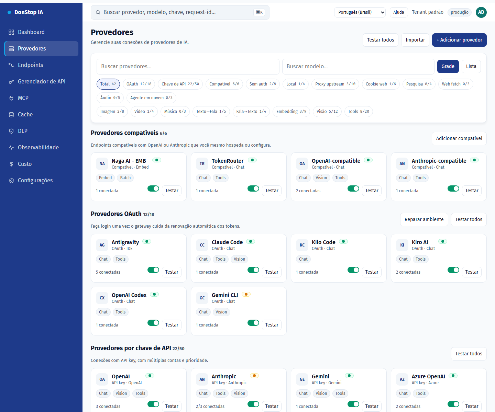
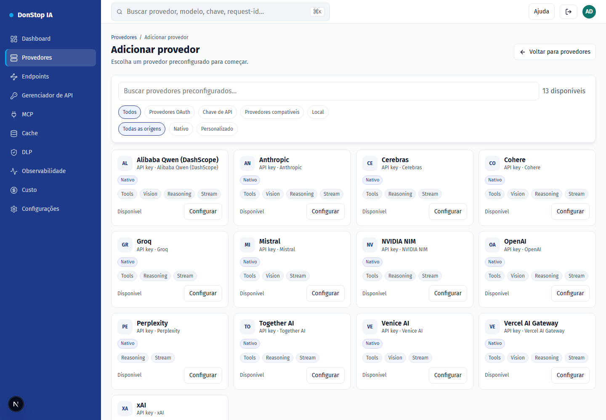
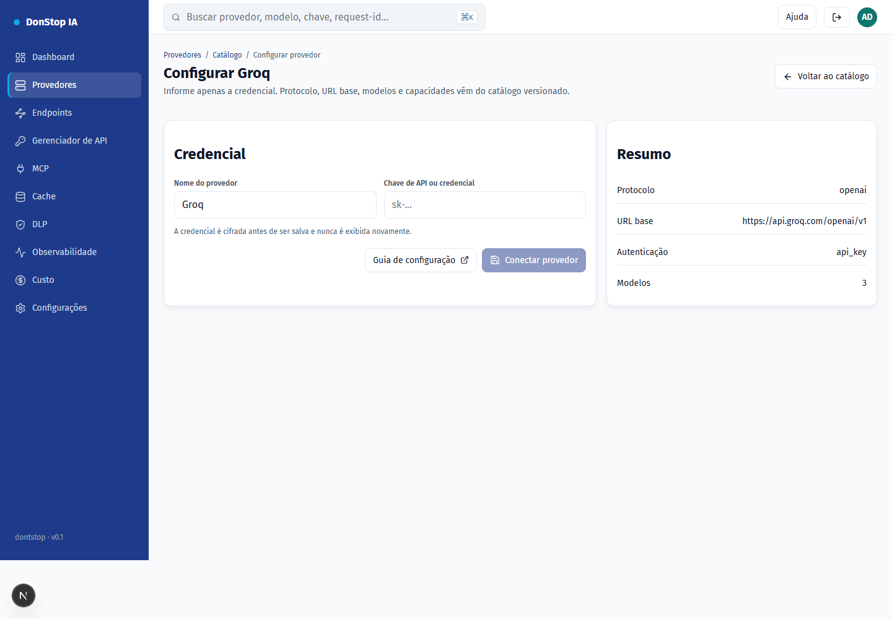
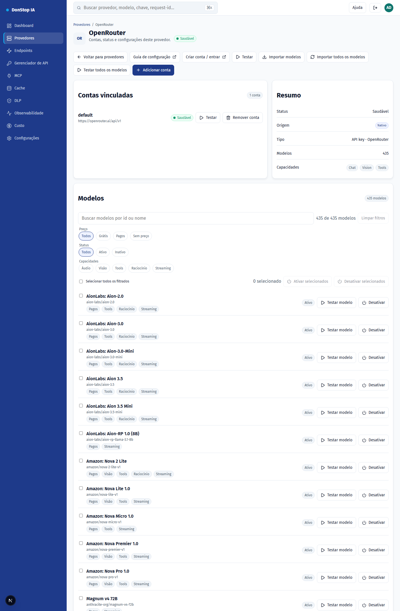

# Configuração de provedores

Cada provedor abaixo já está no catálogo versionado: protocolo, URL base, modelos e capacidades. Você informa apenas a credencial.

## Como configurar

1. Abra Provedores e escolha Adicionar provedor (ou o card do provedor no catálogo).
2. Selecione o provedor e clique em Configurar.
3. Crie a API key no console do provedor (link abaixo).
4. Cole a chave no campo Credencial e confirme.
5. O provedor passa para a lista de configurados; teste e importe modelos se precisar.

## Passo a passo

## Provedores suportados

| Provider | Auth | Base URL |
|---|---|---|
| Alibaba Qwen (DashScope) | API key | https://dashscope-intl.aliyuncs.com/compatible-mode/v1 |
| Anthropic | API key | https://api.anthropic.com |
| Cerebras | API key | https://api.cerebras.ai/v1 |
| Cohere | API key | https://api.cohere.com/compatibility/v1 |
| Groq | API key | https://api.groq.com/openai/v1 |
| Mistral | API key | https://api.mistral.ai/v1 |
| NVIDIA NIM | API key | https://integrate.api.nvidia.com/v1 |
| OpenAI | API key | https://api.openai.com/v1 |
| OpenRouter | API key | https://openrouter.ai/api/v1 |
| Perplexity | API key | https://api.perplexity.ai |
| Together AI | API key | https://api.together.xyz/v1 |
| Venice AI | API key | https://api.venice.ai/api/v1 |
| Vercel AI Gateway | API key | https://ai-gateway.vercel.sh/v1 |
| xAI | API key | https://api.x.ai/v1 |

## Alibaba Qwen (DashScope)

- Auth: API key
- Base URL: https://dashscope-intl.aliyuncs.com/compatible-mode/v1
- Crie a chave no Alibaba Cloud Model Studio (DashScope) e use o endpoint internacional.

## Anthropic

- Auth: API key
- Base URL: https://api.anthropic.com
- O gateway envia x-api-key e anthropic-version; não inclua esses headers manualmente.

## Cerebras

- Auth: API key
- Base URL: https://api.cerebras.ai/v1
- Compatível com OpenAI; use a chave do console da Cerebras.

## Cohere

- Auth: API key
- Base URL: https://api.cohere.com/compatibility/v1
- Use o endpoint de compatibilidade (/compatibility) e a chave do dashboard da Cohere.

## Groq

- Auth: API key
- Base URL: https://api.groq.com/openai/v1
- Compatível com OpenAI; a chave é criada no console da Groq.

## Mistral

- Auth: API key
- Base URL: https://api.mistral.ai/v1
- Compatível com OpenAI; use a chave do console da Mistral.

## NVIDIA NIM

- Auth: API key
- Base URL: https://integrate.api.nvidia.com/v1
- O endpoint de modelos é público; a credencial é exigida nas inferências.

## OpenAI

- Auth: API key
- Base URL: https://api.openai.com/v1
- Use uma chave de projeto. A organizaão/projeto não são enviados pelo gateway.

## OpenRouter

- Auth: API key
- Base URL: https://openrouter.ai/api/v1
- Importe modelos pelo botão Importar modelos ou use o modelo auto.

## Perplexity

- Auth: API key
- Base URL: https://api.perplexity.ai
- Perplexity não expõe /models: o teste e a importação de modelos ficam indisponíveis; o chat funciona.

## Together AI

- Auth: API key
- Base URL: https://api.together.xyz/v1
- Compatível com OpenAI; use a chave em api.together.ai.

## Venice AI

- Auth: API key
- Base URL: https://api.venice.ai/api/v1
- Compatível com OpenAI; a chave é criada em Settings > API.

## Vercel AI Gateway

- Auth: API key
- Base URL: https://ai-gateway.vercel.sh/v1
- Os IDs de modelo são namespaced (ex.: openai/gpt-4.1).

## xAI

- Auth: API key
- Base URL: https://api.x.ai/v1
- Use a chave do console da xAI; o gateway usa o endpoint de chat.

## Filtros e ações em lote

- Filtre por preço (grátis/pago/sem preço), capabilities (áudio, visão, tools, reasoning, streaming), status ou texto.
- Selecione todos os modelos filtrados e ative ou desative de uma vez; o app confirma a quantidade e informa cada falha.
- Os filtros usam metadados do provedor; modelos sem metadados aparecem como "sem metadados" e não são inferidos pelo nome.
## Modelos

- **Sincronizar modelos** importa tudo o que o provedor anuncia e preserva o estado ligado/desligado dos modelos existentes.
- **Testar modelo** envia uma requisição mínima para validar a credencial e a disponibilidade.
- **Ativar/Desativar** define se o modelo aparece em `/v1/models` e recebe tráfego.
- **Testar todos os modelos** enfileira todos os modelos configurados e executa os testes em segundo plano, um por vez.
- **Importar todos os modelos** registra tudo o que o provedor anuncia em um clique.

## Campos

| Field | Description |
|---|---|
| Credencial | API key criada no console do provedor. É cifrada antes de ser salva. |
| Nome do provedor | Rótulo opcional para esta instância. |
| URL base | Sobrescrita opcional; vazio usa o padrão do catálogo. |

## Erros comuns

- 401: chave inválida ou expirada. Crie outra e tente novamente.
- 402: a conta do provedor está sem crédito.
- 429: limite de taxa do provedor. Aguarde o cooldown.
- Provedor fora do catálogo: ainda não existe adapter no gateway.
