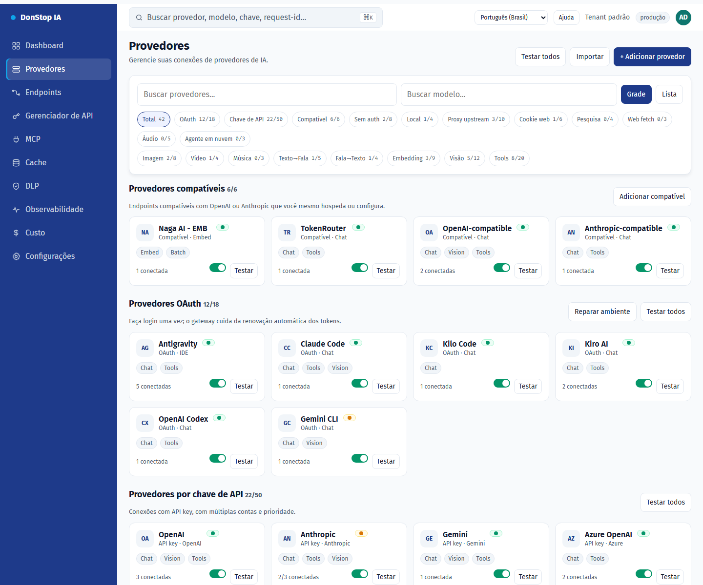

# Provedores

## O que faz

Lista provedores de IA, contas, status de conexão e modelos disponíveis, com visões em grade/lista e testes de conexão.

## Quando usar

Use esta tela quando precisar inspecionar, configurar ou operar esta parte do gateway.

## Passo a passo

1. Abra **Provedores** pela barra lateral.
2. Revise os indicadores e a tabela principal.
3. Use as ações descritas abaixo; as mudanças valem imediatamente.
4. Use Grade/Lista, filtre por autenticação ou capacidade e teste o provedor antes de ativá-lo.

## Campos e ações

| Campo ou ação | Rótulo ou ação visível nesta tela. |
|---|---|
| + Adicionar provedor | Rótulo ou ação visível nesta tela. |
| Grade | Rótulo ou ação visível nesta tela. |
| Lista | Rótulo ou ação visível nesta tela. |
| Testar | Rótulo ou ação visível nesta tela. |
| Status | Rótulo ou ação visível nesta tela. |

## Erros e estados comuns

- Se os dados não carregarem, tente novamente. Se persistir, verifique o gateway e os provedores.
- Se uma ação estiver desabilitada, confirme seu papel e o escopo do tenant.
- Estados vazios são esperados antes da primeira requisição; siga a chamada para ação.

## Proxy por conta

Configure o Webshare em **Rede de proxy**, teste a API key e sincronize a lista de proxies direct. Na conta do provedor, escolha Off, Preferred ou Required; o endpoint atribuído, a região e a saúde aparecem no mesmo bloco. Proxy em quarentena ou ausente cai para conexão direta em Preferred e bloqueia a chamada em Required.

## Contas e testes

O detalhe do provedor mantém o resumo consolidado e adiciona um resumo por conta com estado ativo, saúde, modelos disponíveis/utilizáveis e capacidades. Use o seletor **Conta para teste** acima da lista de modelos para escolher em qual conta o modelo será testado. Apenas contas ativas com modelos utilizáveis são selecionáveis, a última escolha válida é lembrada e o resultado sempre informa a conta usada. Cada conta também tem seu próprio botão de teste; a falha de uma conta não afeta as demais.

## Guias relacionados

- [Endpoints](endpoints.md)
- [Dashboard](dashboard.md)
- [Custo](cost.md)

> Captura de tela de Provedores em Português (Brasil).
