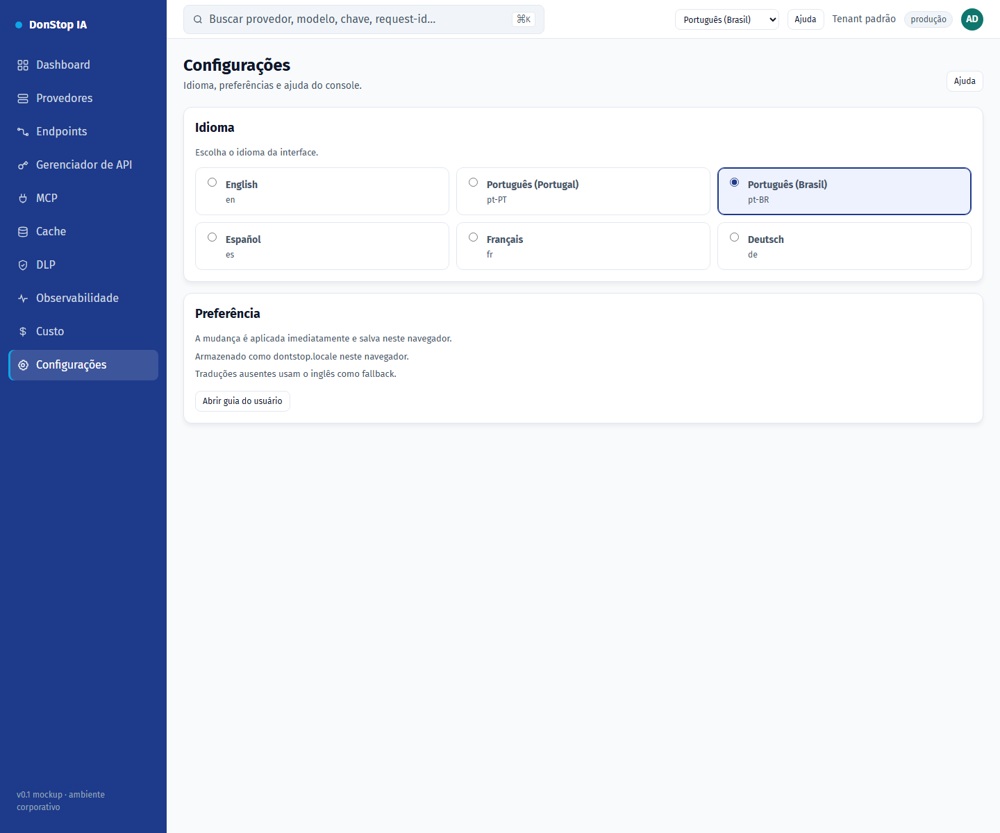

# Configurações

## O que faz

Permite alterar o idioma da interface e revisar onde a preferência é armazenada.

## Quando usar

Use esta tela quando precisar inspecionar, configurar ou operar esta parte do gateway.

## Passo a passo

1. Abra **Configurações** pela barra lateral.
2. Revise os indicadores e a tabela principal.
3. Use as ações descritas abaixo; as mudanças valem imediatamente.
4. Escolha um idioma; a interface atualiza imediatamente e a escolha é salva.

## Campos e ações

| Campo ou ação | Rótulo ou ação visível nesta tela. |
|---|---|
| Idioma | Rótulo ou ação visível nesta tela. |
| Preferência | Rótulo ou ação visível nesta tela. |
| Armazenado como dontstop.locale neste navegador. | Rótulo ou ação visível nesta tela. |
| Traduções ausentes usam o inglês como fallback. | Rótulo ou ação visível nesta tela. |
| Abrir guia do usuário | Rótulo ou ação visível nesta tela. |

## Erros e estados comuns

- Se os dados não carregarem, tente novamente. Se persistir, verifique o gateway e os provedores.
- Se uma ação estiver desabilitada, confirme seu papel e o escopo do tenant.
- Estados vazios são esperados antes da primeira requisição; siga a chamada para ação.

## Guias relacionados

- [Onboarding](onboarding.md)
- [Gerenciador de API](api-manager.md)
- [MCP](mcp.md)

> Captura de tela de Configurações em Português (Brasil).
