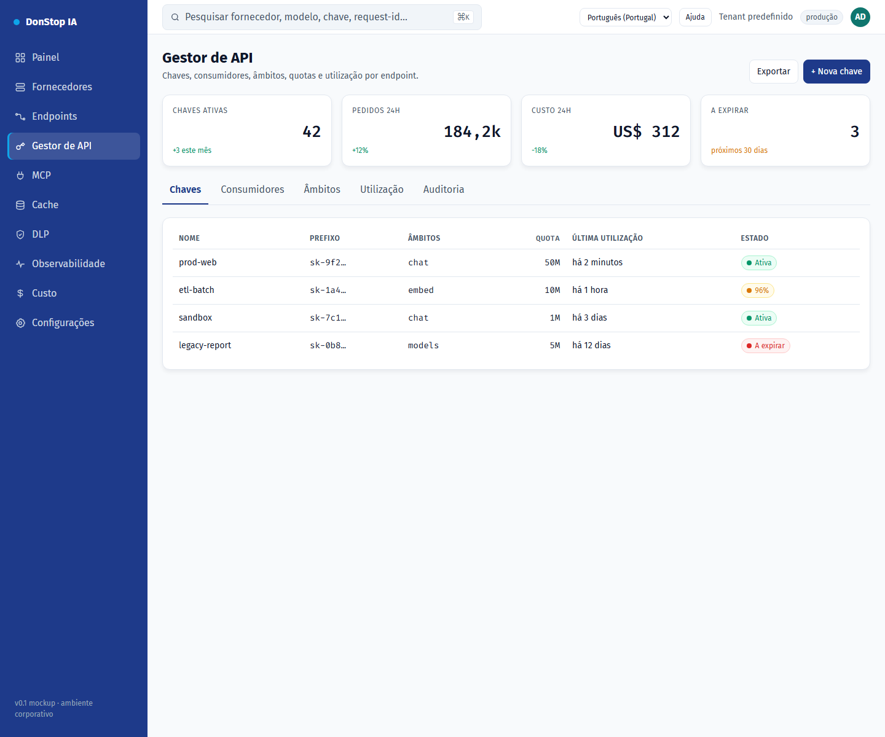

# Gestor de API

## O que faz

Gere chaves de API, âmbitos, quotas, limites de taxa, expiração e utilização por endpoint.

## Quando utilizar

Utilize este ecrã quando precisar de inspecionar, configurar ou operar esta parte do gateway.

## Passo a passo

1. Abra **Gestor de API** na barra lateral.
2. Reveja os indicadores e a tabela principal.
3. Utilize as ações descritas abaixo; as alterações aplicam-se imediatamente.
4. Abra uma chave para rever âmbitos e utilização, ou use + Nova chave para criar uma.

## Campos e ações

| Campo ou ação | Rótulo ou ação visível neste ecrã. |
|---|---|
| + Nova chave | Rótulo ou ação visível neste ecrã. |
| Chaves | Rótulo ou ação visível neste ecrã. |
| Âmbitos | Rótulo ou ação visível neste ecrã. |
| Quota | Rótulo ou ação visível neste ecrã. |
| Última utilização | Rótulo ou ação visível neste ecrã. |
| Estado | Rótulo ou ação visível neste ecrã. |

## Erros e estados comuns

- Se os dados não carregarem, tente novamente. Se persistir, verifique o gateway e os fornecedores.
- Se uma ação estiver desativada, confirme o seu papel e o âmbito do tenant.
- Estados vazios são esperados antes do primeiro pedido; siga a chamada para ação.

## Guias relacionados

- [Nova chave de API](new-api-key.md)
- [Endpoints](endpoints.md)
- [Custo](cost.md)

> Captura de ecrã de Gestor de API em Português (Portugal).
