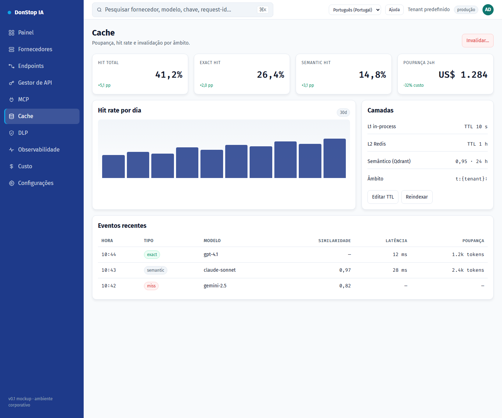

# Cache

## O que faz

Mostra as camadas de cache exato e semântico, hit rate, poupança e ações de invalidação.

## Quando utilizar

Utilize este ecrã quando precisar de inspecionar, configurar ou operar esta parte do gateway.

## Passo a passo

1. Abra **Cache** na barra lateral.
2. Reveja os indicadores e a tabela principal.
3. Utilize as ações descritas abaixo; as alterações aplicam-se imediatamente.
4. Reveja o hit rate e a poupança e invalide por modelo, fornecedor ou tenant se necessário.

## Campos e ações

| Campo ou ação | Rótulo ou ação visível neste ecrã. |
|---|---|
| Cache hit | Rótulo ou ação visível neste ecrã. |
| Poupança 24h | Rótulo ou ação visível neste ecrã. |
| Camadas | Rótulo ou ação visível neste ecrã. |
| Eventos recentes | Rótulo ou ação visível neste ecrã. |
| Invalidar… | Rótulo ou ação visível neste ecrã. |

## Erros e estados comuns

- Se os dados não carregarem, tente novamente. Se persistir, verifique o gateway e os fornecedores.
- Se uma ação estiver desativada, confirme o seu papel e o âmbito do tenant.
- Estados vazios são esperados antes do primeiro pedido; siga a chamada para ação.

## Guias relacionados

- [Custo](cost.md)
- [Observabilidade](observability.md)
- [DLP](dlp.md)

> Captura de ecrã de Cache em Português (Portugal).
