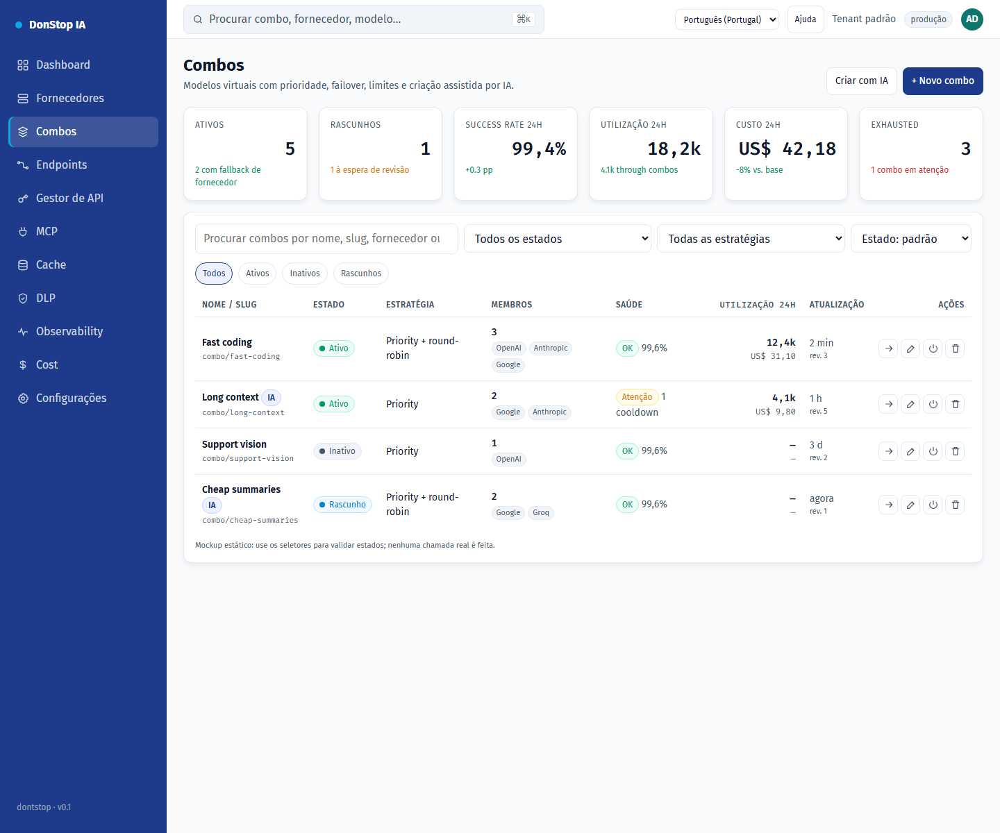

# Combos

## O que faz

Cria e opera modelos virtuais compostos por modelos de fornecedores, com prioridade, failover, limites e rascunho assistido por IA.

## Quando utilizar

Utilize este ecrã quando precisar de inspecionar, configurar ou operar esta parte do gateway.

## Passo a passo

1. Abra **Combos** na barra lateral.
2. Reveja os indicadores e a tabela principal.
3. Utilize as ações descritas abaixo; as alterações aplicam-se imediatamente.
4. Crie manualmente ou com IA, reveja membros e avisos, valide e só então guarde e ative explicitamente.

## Campos e ações

| Campo ou ação | Rótulo ou ação visível neste ecrã. |
|---|---|
| Estado | Rótulo ou ação visível neste ecrã. |
| Editar | Rótulo ou ação visível neste ecrã. |
| Testar | Rótulo ou ação visível neste ecrã. |
| Fechar | Rótulo ou ação visível neste ecrã. |

## Erros e estados comuns

- Se os dados não carregarem, tente novamente. Se persistir, verifique o gateway e os fornecedores.
- Se uma ação estiver desativada, confirme o seu papel e o âmbito do tenant.
- Estados vazios são esperados antes do primeiro pedido; siga a chamada para ação.

## Guias relacionados

- [Fornecedores](providers.md)
- [Endpoints](endpoints.md)
- [Custo](cost.md)

> Captura de ecrã de Combos em Português (Portugal).
