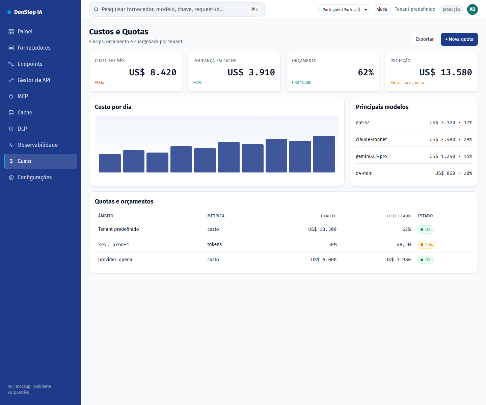

# Custo

## O que faz

Mostra custo diário e mensal, projeção, orçamento e quotas por tenant, chave e fornecedor.

## Quando utilizar

Utilize este ecrã quando precisar de inspecionar, configurar ou operar esta parte do gateway.

## Passo a passo

1. Abra **Custo** na barra lateral.
2. Reveja os indicadores e a tabela principal.
3. Utilize as ações descritas abaixo; as alterações aplicam-se imediatamente.
4. Defina quotas e orçamentos e exporte o relatório de chargeback.

## Campos e ações

| Campo ou ação | Rótulo ou ação visível neste ecrã. |
|---|---|
| Custo hoje | Rótulo ou ação visível neste ecrã. |
| Custo no mês | Rótulo ou ação visível neste ecrã. |
| Projeção | Rótulo ou ação visível neste ecrã. |
| Orçamento | Rótulo ou ação visível neste ecrã. |
| Quotas e orçamentos | Rótulo ou ação visível neste ecrã. |

## Erros e estados comuns

- Se os dados não carregarem, tente novamente. Se persistir, verifique o gateway e os fornecedores.
- Se uma ação estiver desativada, confirme o seu papel e o âmbito do tenant.
- Estados vazios são esperados antes do primeiro pedido; siga a chamada para ação.

## Guias relacionados

- [Painel](dashboard.md)
- [Gestor de API](api-manager.md)
- [Cache](cache.md)

> Captura de ecrã de Custo em Português (Portugal).
