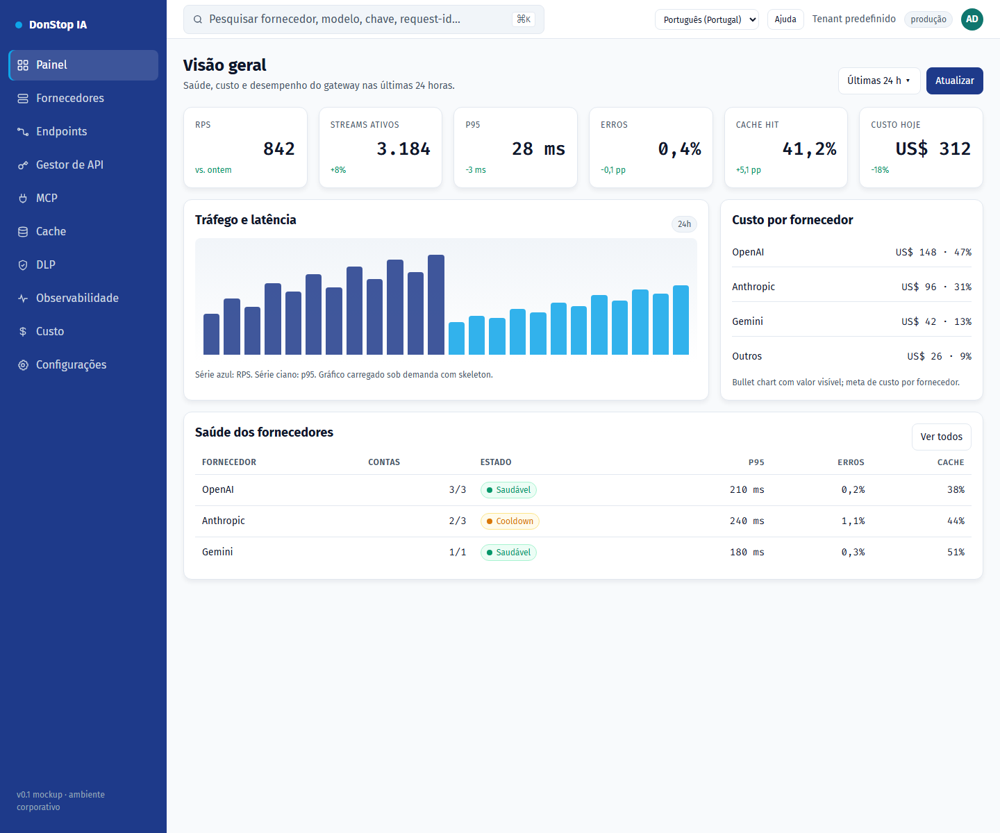

# Painel

## O que faz

Mostra a saúde do gateway, tráfego, custo e estado dos fornecedores nas últimas 24 horas.

## Quando utilizar

Utilize este ecrã quando precisar de inspecionar, configurar ou operar esta parte do gateway.

## Passo a passo

1. Abra **Painel** na barra lateral.
2. Reveja os indicadores e a tabela principal.
3. Utilize as ações descritas abaixo; as alterações aplicam-se imediatamente.
4. Verifique a saúde dos fornecedores e os incidentes antes de abrir um trace detalhado.

## Campos e ações

| Campo ou ação | Rótulo ou ação visível neste ecrã. |
|---|---|
| Chaves ativas | Rótulo ou ação visível neste ecrã. |
| Pedidos 24h | Rótulo ou ação visível neste ecrã. |
| Custo 24h | Rótulo ou ação visível neste ecrã. |
| A expirar | Rótulo ou ação visível neste ecrã. |
| Saúde dos fornecedores | Rótulo ou ação visível neste ecrã. |

## Erros e estados comuns

- Se os dados não carregarem, tente novamente. Se persistir, verifique o gateway e os fornecedores.
- Se uma ação estiver desativada, confirme o seu papel e o âmbito do tenant.
- Estados vazios são esperados antes do primeiro pedido; siga a chamada para ação.

## Guias relacionados

- [Fornecedores](providers.md)
- [Observabilidade](observability.md)
- [Custo](cost.md)

> Captura de ecrã de Painel em Português (Portugal).
