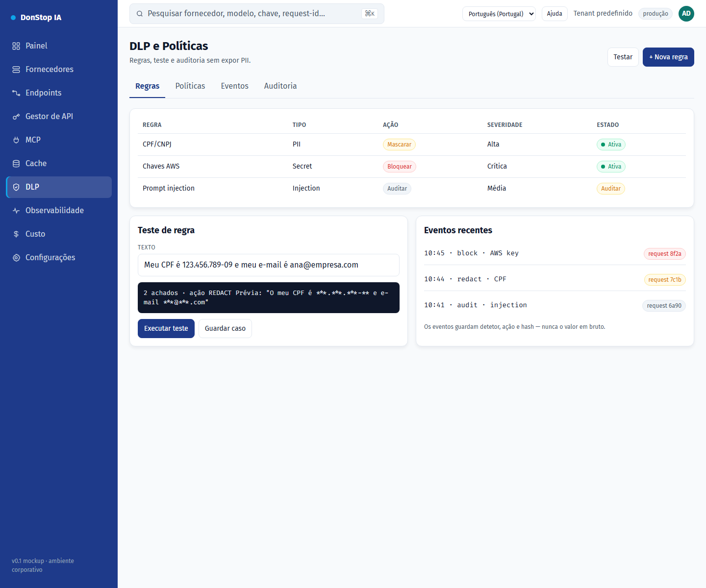

# DLP

## O que faz

Define regras e políticas de DLP, testa a redação e audita eventos sem expor PII.

## Quando utilizar

Utilize este ecrã quando precisar de inspecionar, configurar ou operar esta parte do gateway.

## Passo a passo

1. Abra **DLP** na barra lateral.
2. Reveja os indicadores e a tabela principal.
3. Utilize as ações descritas abaixo; as alterações aplicam-se imediatamente.
4. Execute um teste de regra com texto de exemplo e confirme a ação antes de a ativar.

## Campos e ações

| Campo ou ação | Rótulo ou ação visível neste ecrã. |
|---|---|
| Regras | Rótulo ou ação visível neste ecrã. |
| Ação | Rótulo ou ação visível neste ecrã. |
| Severidade | Rótulo ou ação visível neste ecrã. |
| Estado | Rótulo ou ação visível neste ecrã. |
| Executar teste | Rótulo ou ação visível neste ecrã. |

## Erros e estados comuns

- Se os dados não carregarem, tente novamente. Se persistir, verifique o gateway e os fornecedores.
- Se uma ação estiver desativada, confirme o seu papel e o âmbito do tenant.
- Estados vazios são esperados antes do primeiro pedido; siga a chamada para ação.

## Guias relacionados

- [Observabilidade](observability.md)
- [Gestor de API](api-manager.md)
- [Cache](cache.md)

> Captura de ecrã de DLP em Português (Portugal).
