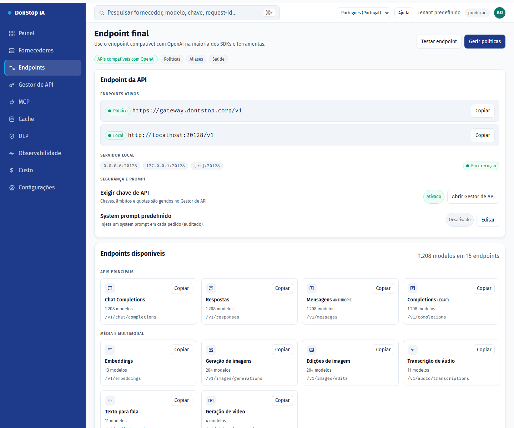

# Endpoints

## O que faz

Mostra o endpoint final da API, URLs pública e local, rotas disponíveis, aliases para CLIs e o system prompt opcional.

## Quando utilizar

Utilize este ecrã quando precisar de inspecionar, configurar ou operar esta parte do gateway.

## Passo a passo

1. Abra **Endpoints** na barra lateral.
2. Reveja os indicadores e a tabela principal.
3. Utilize as ações descritas abaixo; as alterações aplicam-se imediatamente.
4. Copie o URL público ou local e use os aliases para CLIs; não existem túneis.

## Campos e ações

| Campo ou ação | Rótulo ou ação visível neste ecrã. |
|---|---|
| Base URL | Rótulo ou ação visível neste ecrã. |
| Público | Rótulo ou ação visível neste ecrã. |
| Local | Rótulo ou ação visível neste ecrã. |
| Endpoints disponíveis | Rótulo ou ação visível neste ecrã. |
| Aliases para CLIs | Rótulo ou ação visível neste ecrã. |

## Erros e estados comuns

- Se os dados não carregarem, tente novamente. Se persistir, verifique o gateway e os fornecedores.
- Se uma ação estiver desativada, confirme o seu papel e o âmbito do tenant.
- Estados vazios são esperados antes do primeiro pedido; siga a chamada para ação.

## Guias relacionados

- [Gestor de API](api-manager.md)
- [Fornecedores](providers.md)
- [MCP](mcp.md)

> Captura de ecrã de Endpoints em Português (Portugal).
