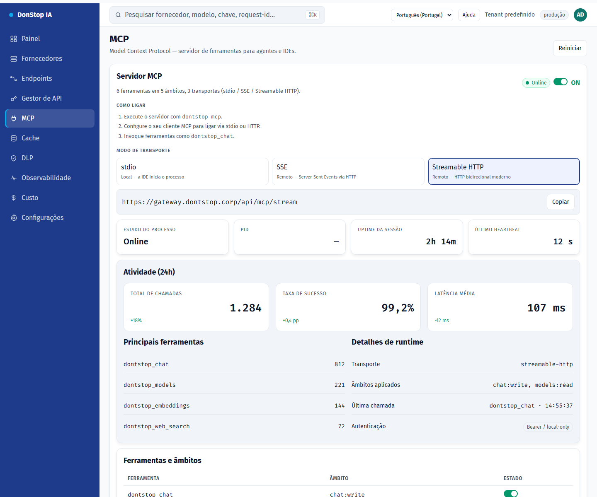

# MCP

## O que faz

Controla o servidor MCP: ativação global, transporte, estado, atividade e ferramentas expostas.

## Quando utilizar

Utilize este ecrã quando precisar de inspecionar, configurar ou operar esta parte do gateway.

## Passo a passo

1. Abra **MCP** na barra lateral.
2. Reveja os indicadores e a tabela principal.
3. Utilize as ações descritas abaixo; as alterações aplicam-se imediatamente.
4. Ative o servidor, escolha um transporte e copie o comando ou o URL.

## Campos e ações

| Campo ou ação | Rótulo ou ação visível neste ecrã. |
|---|---|
| Servidor MCP | Rótulo ou ação visível neste ecrã. |
| Modo de transporte | Rótulo ou ação visível neste ecrã. |
| Atividade (24h) | Rótulo ou ação visível neste ecrã. |
| Ferramentas e âmbitos | Rótulo ou ação visível neste ecrã. |
| Reiniciar | Rótulo ou ação visível neste ecrã. |

## Erros e estados comuns

- Se os dados não carregarem, tente novamente. Se persistir, verifique o gateway e os fornecedores.
- Se uma ação estiver desativada, confirme o seu papel e o âmbito do tenant.
- Estados vazios são esperados antes do primeiro pedido; siga a chamada para ação.

## Guias relacionados

- [Gestor de API](api-manager.md)
- [Endpoints](endpoints.md)
- [Configurações](settings.md)

> Captura de ecrã de MCP em Português (Portugal).
