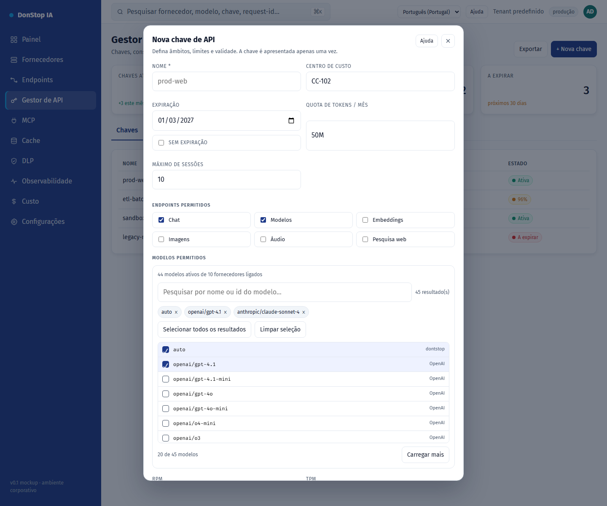

# Nova chave de API

## O que faz

Cria uma chave de API com âmbitos, restrições de modelo, quotas, expiração e limites de IP/sessão.

## Quando utilizar

Utilize este ecrã quando precisar de inspecionar, configurar ou operar esta parte do gateway.

## Passo a passo

1. Abra **Nova chave de API** na barra lateral.
2. Reveja os indicadores e a tabela principal.
3. Utilize as ações descritas abaixo; as alterações aplicam-se imediatamente.
4. Preencha os campos, selecione modelos, crie a chave e copie-a uma única vez.

## Campos e ações

| Campo ou ação | Rótulo ou ação visível neste ecrã. |
|---|---|
| Nome * | Rótulo ou ação visível neste ecrã. |
| Centro de custo | Rótulo ou ação visível neste ecrã. |
| Expiração | Rótulo ou ação visível neste ecrã. |
| Quota de tokens / mês | Rótulo ou ação visível neste ecrã. |
| Endpoints permitidos | Rótulo ou ação visível neste ecrã. |
| Modelos permitidos | Rótulo ou ação visível neste ecrã. |

## Erros e estados comuns

- Se os dados não carregarem, tente novamente. Se persistir, verifique o gateway e os fornecedores.
- Se uma ação estiver desativada, confirme o seu papel e o âmbito do tenant.
- Estados vazios são esperados antes do primeiro pedido; siga a chamada para ação.

## Guias relacionados

- [Gestor de API](api-manager.md)
- [Endpoints](endpoints.md)
- [Custo](cost.md)

> Captura de ecrã de Nova chave de API em Português (Portugal).
