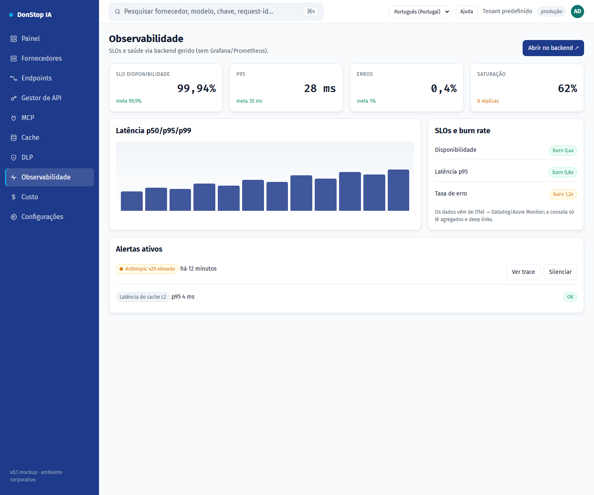

# Observabilidade

## O que faz

Mostra SLOs, disponibilidade, alertas, tráfego e latência, com deep links para o backend gerido.

## Quando utilizar

Utilize este ecrã quando precisar de inspecionar, configurar ou operar esta parte do gateway.

## Passo a passo

1. Abra **Observabilidade** na barra lateral.
2. Reveja os indicadores e a tabela principal.
3. Utilize as ações descritas abaixo; as alterações aplicam-se imediatamente.
4. Use os deep links para abrir traces e detalhes de SLO no backend gerido.

## Campos e ações

| Campo ou ação | Rótulo ou ação visível neste ecrã. |
|---|---|
| Disponibilidade | Rótulo ou ação visível neste ecrã. |
| SLOs e burn rate | Rótulo ou ação visível neste ecrã. |
| Alertas ativos | Rótulo ou ação visível neste ecrã. |
| Tráfego e latência | Rótulo ou ação visível neste ecrã. |
| Abrir no backend ↗ | Rótulo ou ação visível neste ecrã. |

## Erros e estados comuns

- Se os dados não carregarem, tente novamente. Se persistir, verifique o gateway e os fornecedores.
- Se uma ação estiver desativada, confirme o seu papel e o âmbito do tenant.
- Estados vazios são esperados antes do primeiro pedido; siga a chamada para ação.

## Guias relacionados

- [Painel](dashboard.md)
- [DLP](dlp.md)
- [Custo](cost.md)

> Captura de ecrã de Observabilidade em Português (Portugal).
