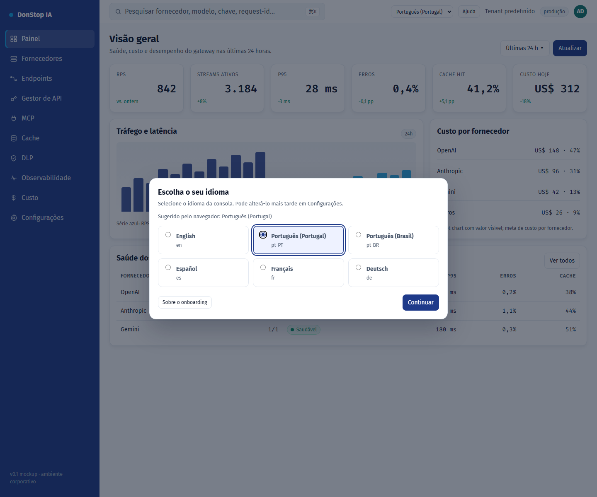

# Onboarding

## O que faz

Aparece no primeiro acesso para escolher o idioma da interface, pré-selecionado pelo navegador.

## Quando utilizar

Utilize este ecrã quando precisar de inspecionar, configurar ou operar esta parte do gateway.

## Passo a passo

1. Abra **Onboarding** na barra lateral.
2. Reveja os indicadores e a tabela principal.
3. Utilize as ações descritas abaixo; as alterações aplicam-se imediatamente.
4. Escolha o idioma sugerido ou outro e selecione Continuar.

## Campos e ações

| Campo ou ação | Rótulo ou ação visível neste ecrã. |
|---|---|
| Idioma da interface | Rótulo ou ação visível neste ecrã. |
| Sugerido pelo navegador: {locale} | Rótulo ou ação visível neste ecrã. |
| Continuar | Rótulo ou ação visível neste ecrã. |
| Sobre o onboarding | Rótulo ou ação visível neste ecrã. |

## Erros e estados comuns

- Se os dados não carregarem, tente novamente. Se persistir, verifique o gateway e os fornecedores.
- Se uma ação estiver desativada, confirme o seu papel e o âmbito do tenant.
- Estados vazios são esperados antes do primeiro pedido; siga a chamada para ação.

## Guias relacionados

- [Configurações](settings.md)
- [Painel](dashboard.md)
- [Gestor de API](api-manager.md)

> Captura de ecrã de Onboarding em Português (Portugal).
