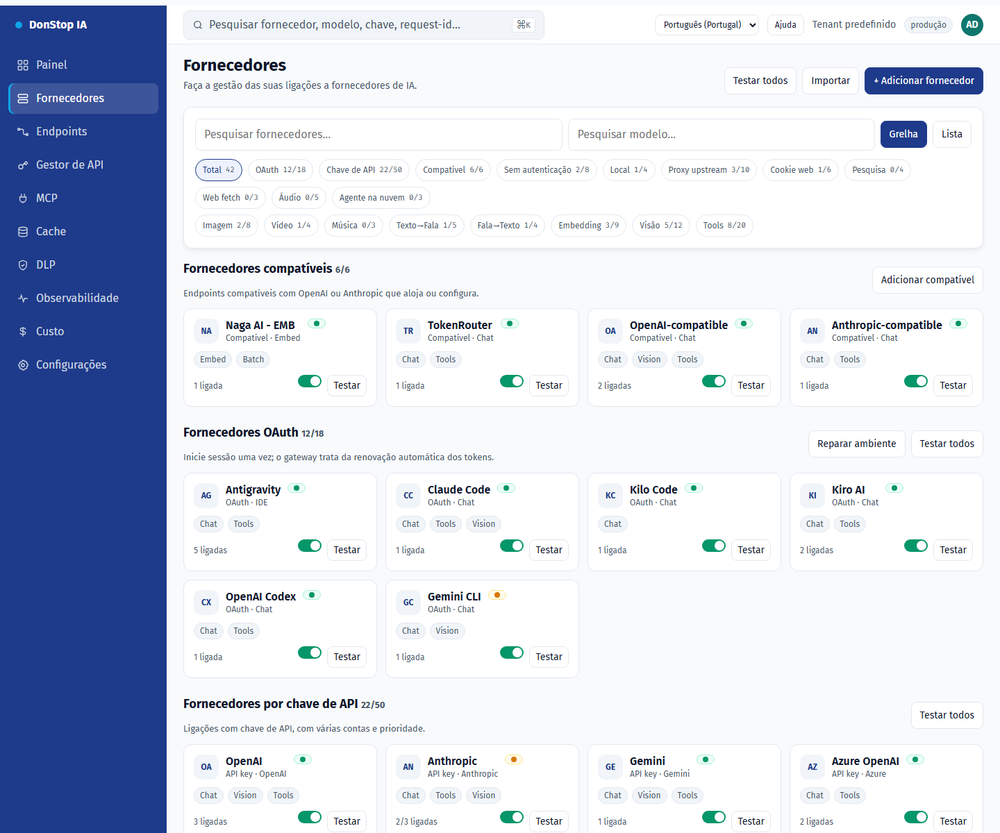

# Fornecedores

## O que faz

Lista fornecedores de IA, contas, estado da ligação e modelos disponíveis, com vistas em grelha/lista e testes de ligação.

## Quando utilizar

Utilize este ecrã quando precisar de inspecionar, configurar ou operar esta parte do gateway.

## Passo a passo

1. Abra **Fornecedores** na barra lateral.
2. Reveja os indicadores e a tabela principal.
3. Utilize as ações descritas abaixo; as alterações aplicam-se imediatamente.
4. Use Grelha/Lista, filtre por autenticação ou capacidade e teste o fornecedor antes de o ativar.

## Campos e ações

| Campo ou ação | Rótulo ou ação visível neste ecrã. |
|---|---|
| + Adicionar fornecedor | Rótulo ou ação visível neste ecrã. |
| Grelha | Rótulo ou ação visível neste ecrã. |
| Lista | Rótulo ou ação visível neste ecrã. |
| Testar | Rótulo ou ação visível neste ecrã. |
| Estado | Rótulo ou ação visível neste ecrã. |

## Erros e estados comuns

- Se os dados não carregarem, tente novamente. Se persistir, verifique o gateway e os fornecedores.
- Se uma ação estiver desativada, confirme o seu papel e o âmbito do tenant.
- Estados vazios são esperados antes do primeiro pedido; siga a chamada para ação.

## Proxy por conta

Configure o Webshare em **Rede de proxy**, teste a API key e sincronize a lista de proxies direct. Na conta do fornecedor, escolha Off, Preferred ou Required; o endpoint atribuído, a região e a saúde aparecem no mesmo bloco. Proxy em quarentena ou ausente recorre à ligação direta em Preferred e bloqueia a chamada em Required.

## Contas e testes

O detalhe do fornecedor mantém o resumo consolidado e adiciona um resumo por conta com estado ativo, saúde, modelos disponíveis/utilizáveis e capacidades. Use o seletor **Conta para teste** acima da lista de modelos para escolher em que conta o modelo será testado. Apenas contas ativas com modelos utilizáveis são selecionáveis, a última escolha válida é memorizada e o resultado indica sempre a conta usada. Cada conta tem também o seu botão de teste; a falha de uma conta não afeta as restantes.

## Guias relacionados

- [Endpoints](endpoints.md)
- [Painel](dashboard.md)
- [Custo](cost.md)

> Captura de ecrã de Fornecedores em Português (Portugal).
