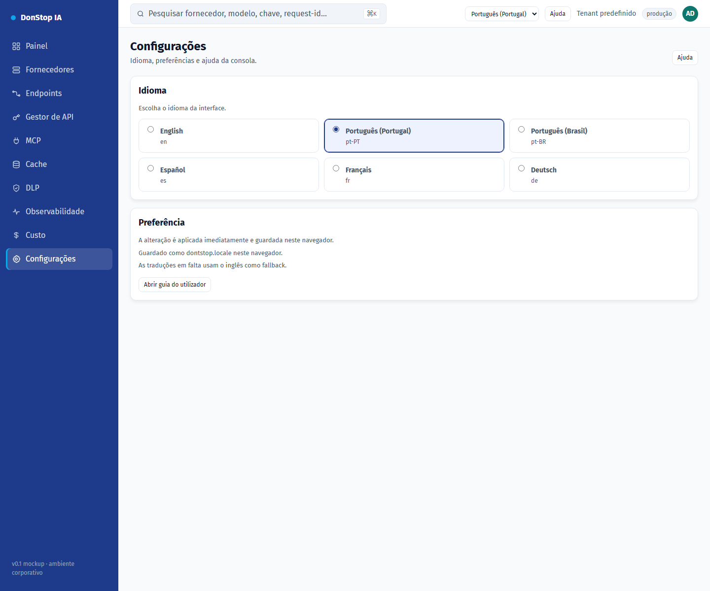

# Configurações

## O que faz

Permite alterar o idioma da interface e rever onde a preferência é guardada.

## Quando utilizar

Utilize este ecrã quando precisar de inspecionar, configurar ou operar esta parte do gateway.

## Passo a passo

1. Abra **Configurações** na barra lateral.
2. Reveja os indicadores e a tabela principal.
3. Utilize as ações descritas abaixo; as alterações aplicam-se imediatamente.
4. Escolha um idioma; a interface atualiza imediatamente e a escolha é guardada.

## Campos e ações

| Campo ou ação | Rótulo ou ação visível neste ecrã. |
|---|---|
| Idioma | Rótulo ou ação visível neste ecrã. |
| Preferência | Rótulo ou ação visível neste ecrã. |
| Guardado como dontstop.locale neste navegador. | Rótulo ou ação visível neste ecrã. |
| As traduções em falta usam o inglês como fallback. | Rótulo ou ação visível neste ecrã. |
| Abrir guia do utilizador | Rótulo ou ação visível neste ecrã. |

## Erros e estados comuns

- Se os dados não carregarem, tente novamente. Se persistir, verifique o gateway e os fornecedores.
- Se uma ação estiver desativada, confirme o seu papel e o âmbito do tenant.
- Estados vazios são esperados antes do primeiro pedido; siga a chamada para ação.

## Guias relacionados

- [Onboarding](onboarding.md)
- [Gestor de API](api-manager.md)
- [MCP](mcp.md)

> Captura de ecrã de Configurações em Português (Portugal).
